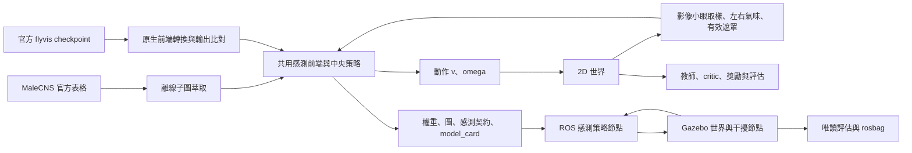

# 果蠅連接體多感官追蹤系統（FlyTrack）

以 flyvis 預訓練早期視覺前端（方案 A）加上 MaleCNS v1.0 中央子圖組成感測策略：先在 2D 模擬器訓練，再匯出模型，最後透過 ROS 2 Lyrical／Gazebo Jetty 做閉環評估。研究問題是比較六個變體（V、O、VO、VO-late、GRU、RS）在相同感測前端之後的追蹤表現。

> **目前進度（2026-10-19）：** 資料、前端、子圖、訓練鏈都已實際跑通，兩台 GPU 主機已校準。**正式訓練還沒開始**，要先解決策略不用氣味（#4）、PPO 沒有改善 BC（#35），並凍結評估協定（#20）。詳細進度見 [docs/status.md](docs/status.md)，待辦與分工見 GitHub Issue [#28](https://github.com/Nues0913/Drosophila_Tracking_System/issues/28)，協作規則見 [AGENT_TEAM_WORKFLOW.md](AGENT_TEAM_WORKFLOW.md)。

## 組員快速上手

### 0. 需求

- Linux x86_64：原生 Ubuntu，或 Windows 上的 WSL2。Colab 也可以，見 [docs/gpu_hosts.md](docs/gpu_hosts.md)。
- NVIDIA GPU，驅動支援 CUDA 12.6。GTX 1050 3 GB 在 PPO 更新時會 OOM，建議 8 GB 以上（未實測下限）。
- 約 5 GB 磁碟空間；只有重新萃取子圖時才需要額外 1.2 GB 原始資料。

### 1. 取得程式與環境

```bash
git clone <repo-url> flytrack && cd flytrack
curl -LsSf https://astral.sh/uv/install.sh | sh     # 已安裝 uv 可略過
uv python install 3.12
uv venv --python 3.12 .venv
uv pip install --python .venv/bin/python --require-hashes -r requirements/ml-cu126-py312.lock
uv pip install --python .venv/bin/python --no-deps -e .
source .venv/bin/activate
python -c "import torch; print(torch.__version__, torch.cuda.is_available())"
```

lock 檔固定 Linux x86_64、Python 3.12、PyTorch 2.9.1+cu126（細節見 [requirements/README.md](requirements/README.md)）。

### 2. 已隨 repo 附上的產物

不需要重新下載原始資料或轉換前端就能開始訓練：

| 路徑 | 內容 |
| --- | --- |
| `data/subgraphs/main/` | MaleCNS 中央子圖（2569 神經元、14165 邊）、`manifest.json`（來源 SHA-256 與設定）、盤點報表 |
| `artifacts/frontend/` | 轉換後的 flyvis 前端 `frontend.npz` 與 parity 驗證 |
| `artifacts/data_execution/*.json` | 候選型別掃描、原始 schema、子圖獨立驗證結果 |

### 3. 確認環境正常

```bash
pytest python/tests                    # 全部應通過（自動使用 artifacts/frontend）
ruff check python scripts
python -m flytrack_train audit-env --config configs/train/evaluate.yaml      # teacher 須成功、盲目策略須失敗
python -m flytrack_train ppo --config configs/train/smoke.yaml --device cuda   # 約 10 秒的小流程
```

### 4. 正式訓練

```bash
python scripts/prepare_experiments.py --algorithm ppo --device cuda
cat runs/experiment_configs/parameter_budget.json      # 六變體參數數須在 VO 的 ±5% 內
bash runs/experiment_configs/run_all.sh                # 6 變體 × 5 種子，每個為 pretrain → BC → PPO
python -m flytrack_train evaluate --config configs/train/evaluate.yaml --device cuda
```

`run_all.sh` 呼叫 `scripts/run_experiments.py`，開始前先審計 BC 與 PPO 的世界（固定動作策略成功率須 ≤10%），每個階段結束後再跑 DN 健康與轉向檢查，未通過就停止該組。`run_all.sh` 預設同時跑 3 組（變體, 種子；`prepare_experiments.py --jobs`），每組內的階段依序執行，中斷後重跑會自動略過已完成並驗證過的階段、從 checkpoint 續跑。額外參數會傳下去，例如 `bash runs/experiment_configs/run_all.sh --seeds 2` 或 `--variants VO --seeds 0 --jobs 1`。環境模擬在 CPU 子行程平行執行（`--workers`，預設依 CPU 數分配），預訓練資料同一種子只收集一次（`runs/datasets/`）。

WSL2 預設只分到主機約一半記憶體；16 GB 筆電建議在 Windows 的 `C:\Users\<帳號>\.wslconfig` 寫入 `[wsl2]`、`memory=12GB`，再於 PowerShell 執行 `wsl --shutdown` 後重開 Ubuntu。筆電訓練時請插電並使用最佳效能電源模式。

先跑單一變體、單一種子確認穩定性與速度，再分工跑完整矩陣。分工方式與注意事項見 [docs/gpu_hosts.md](docs/gpu_hosts.md#分工跑正式訓練)，誰跑哪些組以 PM 開的 GPU 執行 Issue 為準（[AGENT_TEAM_WORKFLOW.md](AGENT_TEAM_WORKFLOW.md#3-算力與重度測試分配)）。`runs/` 不進 git；訓練完成後請把各自的 `runs/<variant>/seed_<n>/actor` 與 log 交回整合。

## 已確認的實作決策

- 主模態為視覺＋嗅覺；溫度感覺留待主模型完成後再評估。
- 早期視覺採方案 A，所有模型共用同一份凍結前端與固定 ORN 轉換。沒有真正的 flyvis 前端產物時，模型建立、訓練與部署會報錯。
- V／O 使用相同完整中央圖與相同參數數，只關閉另一模態輸入。VO-late 使用分離的遞迴狀態、模態子圖和晚期 DN 讀出，型別參數共享。
- GRU 與 RS 比較中央網路結構；研究結論限定在共同感測前端之後的比較。RS 保持入出度、密度和號誌比例，保留原邊的參數共享標籤。
- actor 只接收 `vision`、`odor`、`valid`；教師、critic、獎勵與評估可以讀真值，真值不進入 actor。
- 中央遞迴初始化把 |W| 的譜半徑壓到 `init_spectral_radius`（0.9），否則真實突觸數會讓 ReLU 動態發散；接進運動 DN 的邊另有固定增益 `motor_input_gain`（100），避免方位訊號到 DN 時被一起壓小（見 [MODEL_NOTES](python/flytrack_core/model/MODEL_NOTES.md)）。
- 每回合隨機化目標繞圈方向、半徑與起始位置（2D 與 Gazebo 共用），成功須在 2 m 內**且**朝向目標 45° 內；訓練與正式評估前以 `audit-env` 確認固定動作策略無法成功（見 [SIM_NOTES](python/flytrack_sim/SIM_NOTES.md)）。
- Gazebo 先評估直接移轉的 2D 模型；追加微調另立實驗。
- 核心只依賴 NumPy／PyTorch，ROS 與 Gymnasium 是外層，模組按責任拆分（見下方「目錄與責任」）。

## 目錄與責任

```text
configs/                         感測契約、萃取、模型、訓練與情境設定
python/connectome_extract/       官方表格下載、inventory、路徑式子圖萃取
python/flytrack_core/            契約、神經模型、感測、羽流、軌跡與評估計算
python/flytrack_sim/             2D Gymnasium 環境與特權教師
python/flytrack_train/           預訓練、BC／DAgger、PPO、ES、評估及匯出
python/tests/                    pytest
ros2_ws/src/flytrack_interfaces/ ROS 自訂訊息
ros2_ws/src/flytrack_policy/     感測訂閱、模型推論、看門狗及控制命令
ros2_ws/src/flytrack_world/      氣味、目標、情境、干擾和回合重置
ros2_ws/src/flytrack_eval/       唯讀評估、rosbag 與真值隔離測試
ros2_ws/src/flytrack_bringup/    launch、bridge、差速機器人與場地
docker/                          ML／ROS 兩個映像
scripts/                         flyvis 轉換、實驗設定產生、子圖驗證及主機轉移工具
docs/                            進度、執行紀錄、資料來源與 GPU 主機說明
data/ runs/ artifacts/           原始資料、執行紀錄、模型；只有小型已驗證產物進 git
```



## 觀測、動作與記憶契約

| 項目 | 形狀／單位 |
| --- | --- |
| `vision` | float32 `[2,721]`，左右眼灰階值 `[0,1]` |
| `odor` | float32 `[2]`，左右非負濃度，任意濃度單位 |
| `valid` | float32 `[3]`，左眼、右眼、成對氣味的有效旗標 |
| 動作 | float32 `[2]`，`v` 為 m/s、`omega` 為 rad/s |
| 控制步長 | 50 ms，20 Hz |
| 神經步長 | 10 ms，每個控制步做 5 個子步 |
| 遞迴狀態 | 包含雙眼前端、ORN 適應與中央網路；回合間重置 |

`history_steps=10` 保留觀測儲存／暖啟動規格，策略每次只讀一個重取樣後的新控制步，持續更新隱狀態，不重複灌入整段歷史。訓練使用 32 步的截斷反向傳播；記憶本身不被硬性限制為 0.5 秒。

感測契約在 [configs/sensor_contract.json](configs/sensor_contract.json)。小眼採半徑 15 六角晶格；方向與取樣順序共用同一演算法，前端轉換使用相同座標表。相機為 160×120、水平 120°、向外偏 45°；垂直視野 104.821821° 對應同像素焦距。相機與氣味感測器的前後偏移、左右間距應和 SDF 一併修改。

## 重建資料與前端（一般不需要）

repo 已附上驗證過的子圖與前端。只有要修改萃取設定或重新驗證時才需要以下步驟。

### 子圖萃取

```bash
python python/connectome_extract/download.py --output data/raw          # 約 1.11 GB，不需要 token
python -m connectome_extract inventory --config configs/extraction/main.yaml
python -m connectome_extract extract --config configs/extraction/main.yaml
python scripts/verify_subgraph.py                                       # 對照原始表格的獨立檢查
```

萃取採感覺下游與 DN 上游的有界搜尋交集、突觸門檻及固定點修剪。每個保留的種子型別需可到 DN，子圖需弱連通且在預算內。目前設定的選擇理由寫在 `configs/extraction/main.yaml` 的 `selection_rationale`；候選型別掃描可用 `scripts/scan_candidates.py` 重跑。同資料同設定重跑兩次，產物位元相同。

### flyvis 前端

```bash
python scripts/export_flyvis.py \
  --network-dir /path/to/flyvis/results/flow/0000/000 \
  --sensor-contract configs/sensor_contract.json \
  --output artifacts/frontend/frontend.npz
```

轉換程式展開已學習參數，以灰階、閃光與移動刺激比對官方與原生模型輸出，通過才寫出產物。結果見 [docs/frontend_execution.md](docs/frontend_execution.md)。前端到 LC 種子的空間池化是可配置的工程假設，不是實測感受野。

## 訓練流程細節

```bash
python -m flytrack_train pretrain --config configs/train/pretrain_vision.yaml
python -m flytrack_train pretrain --config configs/train/pretrain_odor.yaml
python -m flytrack_train bc --config configs/train/bc.yaml
python -m flytrack_train ppo --config configs/train/ppo.yaml
```

各階段透過 `init_artifact` 接續同變體模型。預訓練 decoder 留在研究 checkpoint，不隨 actor 匯出；BC 與三輪 DAgger 的標籤來自教師，學生仍只看感測。PPO 使用獨立真值 critic、動作機率轉換、回合重置、終止／截斷分別處理與序列更新。各 CLI 支援 `--seed`、`--device`、`--output`、`--variant`、`--resume`。

PPO 若經診斷仍不穩，所有正式變體統一改跑 ES（`python -m flytrack_train es --config configs/train/es.yaml`）；這是鏡像擾動、秩正規化的 OpenAI ES 風格實作，不是 CMA-ES。

正式比較的預算：預訓練 240,000 步、BC／DAgger 150,000 步、PPO 2,000,000 步，是待校準的初值。評估輸出逐回合 CSV／JSON、種子平均、bootstrap 95% 信賴區間及預先指定的 VO–V／GRU／RS 比較（[configs/evaluation_protocol.yaml](configs/evaluation_protocol.yaml)）。未重新捕獲以截尾資料記錄，不能填成零秒；不會只以差異不顯著就宣稱等效。

## 匯出與 ROS／Gazebo

```bash
python -m flytrack_train export --config configs/train/ppo.yaml \
  --artifact runs/VO/seed_0/actor --output artifacts/VO
cp .env.example .env
docker compose --profile ml --profile sim build
docker compose --profile sim up sim policy eval viz
```

匯出包含 `weights.pt`、`graph.npz`、`frontend.npz`、`sensor_contract.json`、`model_card.json` 和檢查碼；部署時核對雜湊、步長、幾何和形狀，不相符就拒絕載入。Compose 有六個服務、兩種映像：extract／train 使用 ML，sim／policy／eval／viz 使用 ROS。沒有 NVIDIA 容器支援的主機可加 `-f compose.cpu.yaml` 並設定 `TORCH_INDEX_URL=https://download.pytorch.org/whl/cpu`。

策略節點只訂閱 `/fly/*` 感測。單一感測超過 200 ms 以缺失輸入繼續，全部逾時停車；回合控制透過 `/connectome_policy_node/reset` 清除神經與感測緩衝。Foxglove bridge 使用 port 8765。

主要四模型的 Gazebo 批次評估與 lesion 分析：

```bash
python scripts/run_gazebo_matrix.py
python -m flytrack_train evaluate --config configs/train/evaluate_gazebo_recorded.yaml
python scripts/lesion_analysis.py --artifact artifacts/VO
```

lesion 的來源電流分析是描述性診斷，不能當成因果貢獻證明。ROS／Gazebo 目前只完成映像建置，閉環驗證進度見 [docs/ros_execution.md](docs/ros_execution.md)。

### 延遲指標的兩種時鐘

`use_sim_time` 用來計算回合、軌跡、感測過期和行為指標。`/fly/inference_latency_ms` 記錄實際推論的 wall time。完整 sensor-to-command 的因果計時已有契約與實作（`SensorTiming.msg`、`ControlTrace.msg`、`flytrack_eval.latency.CausalLatency`），但還沒有在 Gazebo 閉環中實測與驗證覆蓋率（#22），目前不能宣稱達到計劃書的 p95 <50 ms。

## 文件索引

- [docs/status.md](docs/status.md)：目前進度、已知問題、下一步（**先讀這份**）
- [AGENT_TEAM_WORKFLOW.md](AGENT_TEAM_WORKFLOW.md)：三人（Agent）分工、Issue／PR 與審查規範（參與開發前先讀）
- [後續計畫.md](後續計畫.md)：分階段檢查清單
- [docs/gpu_hosts.md](docs/gpu_hosts.md)：在 Linux／WSL2／Colab 跑訓練與分工
- [docs/execution_log.md](docs/execution_log.md)：執行環境與驗證證據
- [docs/data_sources.md](docs/data_sources.md)：資料來源、授權、雜湊
- [docs/requirements_traceability.md](docs/requirements_traceability.md)：計劃書驗收對照
- `python/*/…_NOTES.md`：各套件設計筆記

## 授權與引用

MaleCNS v1.0 資料為 CC-BY 4.0，報告須引用 FlyEM／Janelia 等來源（見 [docs/data_sources.md](docs/data_sources.md)）。前端參數來自 [flyvis](https://github.com/TuragaLab/flyvis) 官方預訓練模型。
