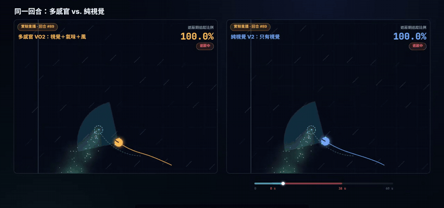
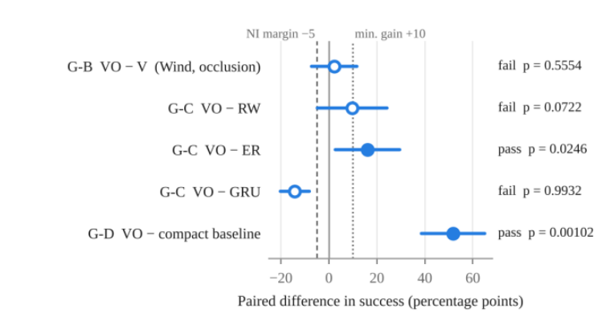
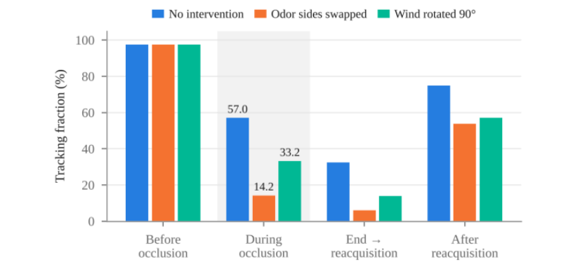
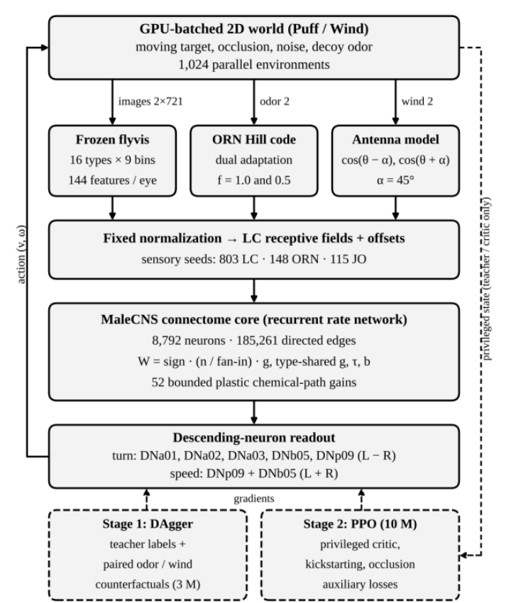

# FlyTrack

Target tracking with a controller built from the *Drosophila* male CNS connectome.

[](https://github.com/Nues0913/Drosophila_Tracking_System/actions/workflows/ci.yml)
[](LICENSE)
[](https://github.com/Nues0913/Drosophila_Tracking_System/releases/tag/formal-v2)

<p align="center">
  <a href="https://youtu.be/Dj_BiW-q4VQ">
    
  </a>
  <br>
  <b><a href="https://youtu.be/Dj_BiW-q4VQ">▶ Watch the project video on YouTube</a></b> (4 min, in Chinese)
</p>

<p align="center">
  <a href="docs/v2/report.md">Report</a> ·
  <a href="https://github.com/Nues0913/Drosophila_Tracking_System/releases/tag/formal-v2">Release</a> ·
  <a href="https://github.com/Nues0913/Drosophila_Tracking_System/releases/tag/research-v2-formal">Pretrained weights</a> ·
  <a href="README.zh-TW.md">繁體中文</a>
</p>

FlyTrack is a course research project. The controller is a recurrent rate network whose wiring comes from an 8,792-neuron subgraph of the MaleCNS v1.0 connectome. It sees the world through compound eyes, smells with both antennae, and senses wind direction. Its outputs are forward speed and turning rate, read from five descending-neuron types on each side of the brain. We train it in GPU-batched 2D worlds, first with DAgger and then with recurrent PPO, and run the trained policy in ROS 2 / Gazebo.

In formal-v2 we tested whether odor and wind help the policy keep following a target that is hidden from view. The policy does respond to both cues, but its success rate under occlusion improved by only 2.2 percentage points over a vision-only policy. That was short of the +10 pp we had pre-registered.

## Results

Six variants were trained with five seeds each:

- VO2: vision, odor, and wind
- V2: vision only
- O2: odor and wind only
- RW2: degree-preserving rewired graph
- ER2: random graph
- GRU2: GRU with a matched parameter count

All gates were fixed in the [evaluation protocol](configs/v2/evaluation_protocol.yaml) before formal training started.

| Gate | Comparison | Result | |
| --- | --- | --- | --- |
| G-A | VO2 success on curved targets, normal scenario (≥ 80%) | 100.0% puff world, 98.8% wind world | pass |
| G-B | VO2 − V2 under occlusion, wind world (≥ +10 pp) | +2.2 pp (19.9% vs 17.7%), Holm p = 0.555 | fail |
| G-C | VO2 noninferior to RW2, ER2, GRU2 (margin −5 pp) | ER2 +16.0 pp, RW2 +9.7 pp (p = 0.072), GRU2 −14.2 pp | fail |
| G-D | VO2 − v1 connectome policy (VO-late) | +51.8 pp (100.0% vs 48.2%), Holm p = 0.001 | pass |
| G-E | Training throughput vs. the v1 trainer on the same GPU | 6.06–11.13× | pass |

<p align="center">
  
  <br>
  <sub>One wind-world episode. The target is hidden from 8 s to 38 s. Left: VO2. Right: V2.</sub>
</p>

Swapping the left and right odor during occlusion lowered VO2's tracking fraction in that window from 57.0% to 14.2%. Rotating the wind by 90° lowered it to 33.2%. Both drops are significant after Holm correction, so the policy does use these inputs. VO2 also stayed with the hidden target more than V2 did (57.0% vs 40.6% of the occlusion window). It hit the target more often as well, with collisions in 41.7% of episodes against 15.0% for V2, which is why overall success barely changed.

As a post-hoc check outside the protocol, we re-ran the same occlusion episodes with target contact no longer ending the episode (walls still did). VO2 then succeeded in 29.9% of episodes and V2 in 18.9%, a difference of +11.0 pp (95% t interval −0.1 to +22.1, one-sided p = 0.025 before correction). Most of the difference came from wandering targets (+19.4 pp).

We think part of the reason is anatomical. Olfactory projection neurons receive input from both antennae, and in our model about 79% of the left–right odor difference cancels at that first synapse. Most of the odor steering that is left goes through a two-synapse path to DNb05.

<p align="center">
  
  
</p>

In Gazebo we ran a compatibility check in the puff world: 48 paired episodes with the seed-100 VO2 and V2 policies. All 48 episodes had the same outcome as in 2D. Sensor-to-command latency (p95) was 42.4 ms for VO2 and 42.1 ms for V2.

The [v2 report](docs/v2/report.md) has the full analysis, in Traditional Chinese.

## Method

<p align="center">
  
</p>

The subgraph is the intersection of a downstream search from visual, olfactory, and wind sensory neurons and an upstream search from the descending neurons. It has 803 LC, 148 ORN, and 115 JO seed neurons. Weights are signed synapse counts normalized by fan-in, and gains, time constants, and biases are shared within each cell type. The visual input comes from a frozen [flyvis](https://github.com/TuragaLab/flyvis) model with 144 features per eye.

Training has two stages:

1. DAgger, 3 M steps. Paired odor and wind counterfactuals push the network to use these cues.
2. Recurrent PPO, 10 M steps, with a privileged critic, kickstarting, and occlusion auxiliary losses.

The policy never receives the target position.

The details are in the v2 docs:

- [subgraph.md](docs/v2/subgraph.md): subgraph extraction
- [model.md](docs/v2/model.md): network model and readout
- [interfaces.md](docs/v2/interfaces.md): sensor inputs
- [world.md](docs/v2/world.md): simulation worlds
- [train.md](docs/v2/train.md): training
- [metrics.md](docs/v2/metrics.md): evaluation

In the code the puff world is called `v1compat` and the wind world is called `wind`.

## Installation

Tested on Linux x86_64 (native and WSL2) with Python 3.12 and CUDA 12.6. The subgraphs and the converted flyvis frontend are included in the repository.

```bash
git clone https://github.com/Nues0913/Drosophila_Tracking_System.git flytrack && cd flytrack
uv python install 3.12
uv venv --python 3.12 .venv
uv pip install --python .venv/bin/python --require-hashes -r requirements/ml-cu126-py312.lock  # CPU only: ml-cpu-py312.lock
uv pip install --python .venv/bin/python --no-deps -e .
source .venv/bin/activate
python -m pytest -m "not slow and not gpu and not ros and not legacy and not bench" -q
```

## Usage

### Evaluate a pretrained policy

Weights for all 60 formal checkpoints are on the [research-v2-formal](https://github.com/Nues0913/Drosophila_Tracking_System/releases/tag/research-v2-formal) release. There is one archive per training machine: `gputw3090` (seeds 1–2), `4060` (seed 3), `2060` (seed 4), and `4070` (seed 5).

```bash
gh release download research-v2-formal -p 'v2_formal_2060_weights.tar.gz' -p 'v2_formal_2060_SHA256SUMS'
sha256sum -c v2_formal_2060_SHA256SUMS
mkdir -p runs/formal_weights && tar xzf v2_formal_2060_weights.tar.gz -C runs/formal_weights
python scripts/v2/evaluate_v2.py \
  --artifacts runs/formal_weights/VO2/seed_4/stage2/final \
  --seeds formal_evaluation --worlds wind --motions curved --episodes 2 \
  --no-sensitivity --device cpu --output runs/eval_demo
```

This takes about a minute on a CPU. The results go to `episodes.jsonl` and `secondary.jsonl`, whose format is described in [metrics.md](docs/v2/metrics.md).

### Train

`scripts/v2/run_formal.py` trains and evaluates all six variants for the given seeds. A toy-sized run checks the setup in about 13 minutes on an RTX 2060:

```bash
python scripts/v2/run_formal.py --host 2060 --seeds 100 --sha "$(git rev-parse HEAD)" --smoke --out runs/smoke
```

To reproduce formal-v2, run seeds 1–5 without `--smoke`. The runner uses the formal recipe, [a3_v15.yaml](configs/v2/train/a3_v15.yaml). One seed took about 17 hours on an RTX 2060. `--host` picks the batch settings for your GPU from [hosts.yaml](configs/v2/train/hosts.yaml).

### Run in ROS 2 / Gazebo

```bash
docker compose --profile sim build
export ARTIFACT=/workspace/runs/formal_weights/VO2/seed_4/stage2/final
export SENSOR_CONTRACT=$ARTIFACT/sensor_contract.json
docker compose --profile sim up sim policy eval viz
```

The policy node publishes `/cmd_vel` at 20 Hz. A v2 model must be paired with its own `sensor_contract.json`, as above. Foxglove can connect to `ws://localhost:8765`. Without NVIDIA container support, add `-f compose.yaml -f compose.cpu.yaml`. `scripts/run_gazebo_matrix.py` runs batches of episodes.

## Repository structure

```text
python/flytrack_v2/         v2 model, GPU worlds, DAgger and PPO, evaluation
python/flytrack_core/       contracts, connectome core, flyvis frontend
python/connectome_extract/  MaleCNS download and subgraph extraction
python/flytrack_sim/        v1 environment (baseline for G-D)
python/flytrack_train/      v1 training and evaluation
scripts/v2/                 formal runner, evaluation, statistics
configs/v2/                 sensor contract, evaluation protocol, training configs
data/subgraphs/             extracted subgraphs (CC BY 4.0)
artifacts/                  converted flyvis frontend, input normalization
ros2_ws/                    ROS 2 packages
docs/                       documentation and reports
```

## Limitations

- We chose the training recipe by looking at VO2 only, which favors VO2 in G-B and G-C. Five seeds also give limited statistical power.
- Visual neurons of the same type on the same side share one receptive field, because MaleCNS does not give per-cell retinotopy for these types.
- Reading forward speed from DNp09 and DNb05 is our modeling choice. It is not an established physiological result.
- Gazebo was tested in the puff world only.

## History

The first formal version, [formal-v1](https://github.com/Nues0913/Drosophila_Tracking_System/releases/tag/formal-v1) (2026-10-28), used a 4,502-neuron graph and CPU worlds ([report](docs/formal_v1_report.md)). The current version is [formal-v2](https://github.com/Nues0913/Drosophila_Tracking_System/releases/tag/formal-v2) (2026-11-24).

## Team

[@Nues0913](https://github.com/Nues0913), [@MiLong9487](https://github.com/MiLong9487), [@cweiting731](https://github.com/cweiting731)

## Citation

```bibtex
@software{flytrack2026,
  title   = {FlyTrack: Connectome-Constrained Multisensory Target Tracking},
  author  = {{FlyTrack contributors}},
  year    = {2026},
  version = {formal-v2},
  url     = {https://github.com/Nues0913/Drosophila_Tracking_System}
}
```

Please also cite the data and models this project builds on:

- S. Berg et al. Sexual dimorphism in the complete *Drosophila* male central nervous system connectome. *Cell* 189(18):5504–5526.e15, 2026. [doi:10.1016/j.cell.2026.08.015](https://doi.org/10.1016/j.cell.2026.08.015)
- J. K. Lappalainen et al. Connectome-constrained networks predict neural activity across the fly visual system. *Nature*, 2024. [doi:10.1038/s41586-024-07939-3](https://doi.org/10.1038/s41586-024-07939-3)

## License

Our code is under the [MIT License](LICENSE). Two parts of the repository keep their original licenses:

- The subgraphs in `data/subgraphs/` are derived from MaleCNS v1.0 and stay under CC BY 4.0.
- The frontend in `artifacts/` is converted from flyvis (MIT).

See [THIRD_PARTY_NOTICES.md](THIRD_PARTY_NOTICES.md) for details.

## Acknowledgements

The MaleCNS connectome was produced by FlyEM (HHMI Janelia), the University of Cambridge Department of Zoology, the MRC Laboratory of Molecular Biology, and Google Research. We thank the flyvis authors for releasing their pretrained models.
