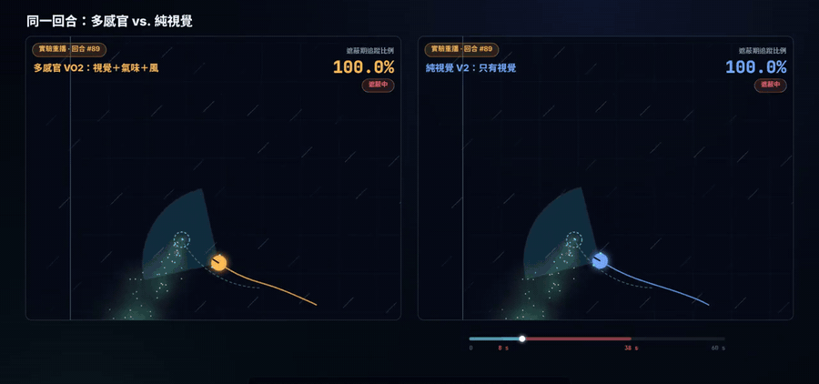
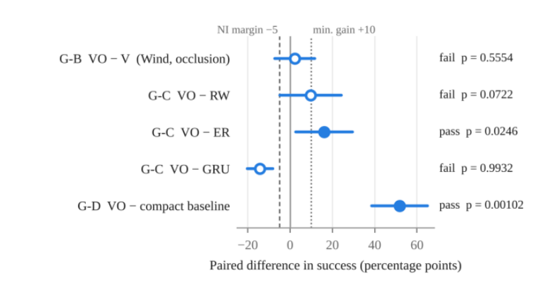
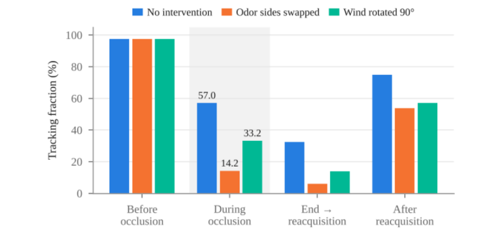
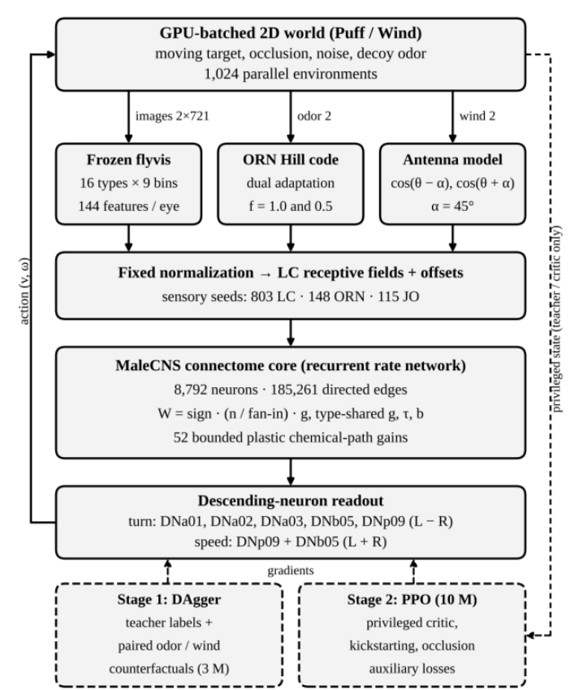

# FlyTrack：以連接體約束的多感官目標追蹤

[](https://github.com/Nues0913/Drosophila_Tracking_System/actions/workflows/ci.yml)
[](https://github.com/Nues0913/Drosophila_Tracking_System/releases/tag/formal-v2)
[](LICENSE)
[](THIRD_PARTY_NOTICES.md)


[English](README.md) · **繁體中文** · [報告](docs/v2/report.md) · [Release](https://github.com/Nues0913/Drosophila_Tracking_System/releases/tag/formal-v2) · [預訓練權重](https://github.com/Nues0913/Drosophila_Tracking_System/releases/tag/research-v2-formal) · [影片](https://youtu.be/Dj_BiW-q4VQ)

FlyTrack 是一個目標追蹤代理人，控制器依照成年雄果蠅中樞神經系統的連接體（MaleCNS v1.0）接線。我們從中取出 8,792 顆神經元的子圖，建成循環發放率網路。網路接收複眼影像、左右觸角的氣味和風，經由下行神經元輸出前進速度和轉向。訓練用模仿學習和循環 PPO，在 GPU 批次化的 2D 世界中進行；評估照事先登記的協定；同一個策略也部署到 ROS 2／Gazebo。

我們要回答的問題是：**目標從視野中消失時，氣味和風能不能讓以連接體約束的控制器繼續追蹤？**

<p align="center">
  
</p>
<p align="center"><sub>取自<a href="https://youtu.be/Dj_BiW-q4VQ">專案影片</a>（4 分鐘）。風世界的一個回合，目標在 8 秒到 38 秒之間被遮住。左邊 VO2（視覺＋氣味＋風）一直待在目標附近，右邊 V2（只有視覺）跟丟了。這只是單一回合；在正式評估的 1,000 個遮蔽回合中，整回合成功率 VO2 是 19.9%、V2 是 17.7%（見<a href="#正式結果formal-v2">正式結果</a>）。</sub></p>

## 重點

- **連接體控制器**：依型別設門檻取出的 MaleCNS 子圖（8,792 顆神經元、185,261 條有向邊），把 803 顆小葉柱狀視覺神經元、148 顆嗅覺受器神經元、115 顆約翰斯頓器官的風感神經元，連到五種左右成對的下行神經元。突觸的正負號和數量來自資料，動態是簡化的發放率模型。
- **有生物依據的感測**：凍結的 [flyvis](https://github.com/TuragaLab/flyvis) 早期視覺系統（每眼 144 個特徵）、有完全和部分適應的嗅覺受器編碼，以及觸角的風向模型。
- **針對微弱線索的訓練**：先用成對觀測的 DAgger，讓策略在反事實的氣味和風輸入上接受監督；再用帶特權 critic 和 kickstarting 的循環 PPO 微調。部署的策略看不到目標位置。
- **快速模擬**：GPU 批次化的世界有 puff 和絲狀 plume，可同時跑 1,024 個環境。同一張 GPU 上，訓練吞吐量是 v1 訓練器的 6–11 倍。
- **事先登記的評估**：六個模型變體 × 五個訓練 seed，76,000 個主要評估回合，配對單尾檢定加 Holm 校正，沒通過的結果照實列出。

## 正式結果（formal-v2）

六個變體共用感覺編碼器和訓練流程：VO2（視覺＋氣味＋風）、V2（只有視覺）、O2（只有氣味＋風）、RW2（保留度數的重接線圖）、ER2（隨機圖）、GRU2（參數量相當的 GRU）。各閘門在正式訓練前就已凍結（[協定](configs/v2/evaluation_protocol.yaml)）。

| 閘門 | 比較 | 結果 | 判定 |
| --- | --- | --- | --- |
| G-A 行為 | VO2 曲線目標、正常情境的成功率，門檻 80% | 100.0%（puff 世界）· 98.8%（風世界） | ✅ 通過 |
| G-B 多感官 | VO2 − V2，風世界遮蔽，至少 +10 個百分點 | +2.2 個百分點（19.9% 對 17.7%），Holm p = 0.555 | ❌ 未通過 |
| G-C 結構 | VO2 不劣於 RW2、ER2、GRU2（界值 −5 個百分點） | ER2 +16.0（通過）· RW2 +9.7（p = 0.072）· GRU2 −14.2 | ❌ 未通過 |
| G-D 對 v1 | VO2 − v1 連接體策略（VO-late） | +51.8 個百分點（100.0% 對 48.2%），Holm p = 0.001 | ✅ 通過 |
| G-E 工程 | 同一張 GPU 上對 v1 訓練器的吞吐量；CI | 6.06–11.13 倍；CI 全綠 | ✅ 通過 |

<p align="center">
  
  &nbsp;
  
</p>
<p align="center"><sub>左：事先登記的配對比較（五個 seed 的平均與 95% t 區間），實心點為通過。右：VO2 各遮蔽時段的追蹤比例，分別是不干預，以及遮蔽期間交換左右氣味、把風向轉 90°。</sub></p>

- **策略確實會用化學線索**：遮蔽期間交換左右氣味，VO2 的追蹤比例從 57.0% 掉到 14.2%（−42.8 個百分點）；把風轉 90°，掉到 33.2%（−23.8 個百分點）。兩者經 Holm 校正後都顯著。
- **靠得近不等於安全**：遮蔽期間 VO2 跟住目標的時間比 V2 多（57.0% 對 40.6%），但碰撞的回合也多（41.7% 對 15.0%），所以整回合成功率幾乎沒變。
- **氣味訊號為什麼弱**：我們的診斷顯示，嗅覺投射神經元同時接收左右觸角的輸入，左右氣味差在第一個突觸就抵消了約 79%；傳到轉向神經元時，差異已經縮小五個數量級以上。剩下的氣味轉向幾乎都經由一條通往 DNb05 的兩突觸捷徑。
- **部署**：在 ROS 2／Gazebo 的 puff 世界做相容性檢查（seed 100 的 VO2、V2 actor，共 48 回合），48 個配對回合全部和 2D 結果一致。感測到指令的 p95 延遲為 42.4 ms（VO2）和 42.1 ms（V2）。

完整分析，包括選出正式配方的探索軌，見 [v2 報告](docs/v2/report.md)。

## 方法

<p align="center">
  
</p>

| 元件 | 做什麼 | 細節 |
| --- | --- | --- |
| 子圖萃取 | 從感覺種子往下游搜尋，和從下行神經元往上游的搜尋取交集，依型別設突觸門檻。每個必要的 DN 都保留至少 40% 的全腦輸入。 | [subgraph.md](docs/v2/subgraph.md) |
| 連接體核心 | 依扇入正規化的帶號權重；同型別共用增益、時間常數和偏置；化學感覺路徑上有 52 個有界的可塑增益 | [model.md](docs/v2/model.md) |
| 感測 | 721 個小眼的六角複眼、凍結的 flyvis 前端、雙重適應的 ORN 編碼、觸角風感 | [interfaces.md](docs/v2/interfaces.md) |
| 讀出 | 轉向取 DNa01、DNa02、DNa03、DNb05、DNp09 的左右差；前進速度取 DNp09 和 DNb05 | [model.md](docs/v2/model.md) |
| 世界 | puff 世界（和 v1 相容）與有絲狀 plume 的風世界；含遮蔽、感測雜訊和氣味誘餌 | [world.md](docs/v2/world.md) |
| 訓練 | 第一階段：成對觀測的 DAgger（300 萬步）。第二階段：循環 PPO（1,000 萬步），帶特權 critic、kickstarting 和遮蔽輔助損失 | [train.md](docs/v2/train.md) |
| 評估 | 逐回合紀錄、以 seed 為單位的配對統計、感覺歸因干預 | [metrics.md](docs/v2/metrics.md) |

程式和設定檔裡，puff 世界叫 `v1compat`，風世界叫 `wind`。

## 開始使用

### 需求

- Linux x86_64（原生或 WSL2），用 [uv](https://docs.astral.sh/uv/) 安裝 Python 3.12。
- 訓練需要支援 CUDA 12.6 的 NVIDIA GPU。正式訓練用過 RTX 2060（6 GB，開啟 activation checkpointing）到 RTX 3090。評估也可以只用 CPU。
- 部署需要 Docker 和 Compose 2.30 以上，NVIDIA 容器支援可有可無。

萃取好的子圖、轉換後的 flyvis 前端和輸入正規化都已放在 repo 裡，不需要下載連接體。

### 安裝

```bash
git clone https://github.com/Nues0913/Drosophila_Tracking_System.git flytrack && cd flytrack
uv python install 3.12
uv venv --python 3.12 .venv
uv pip install --python .venv/bin/python --require-hashes -r requirements/ml-cu126-py312.lock  # 只用 CPU：ml-cpu-py312.lock
uv pip install --python .venv/bin/python --no-deps -e .
source .venv/bin/activate
python -m pytest -m "not slow and not gpu and not ros and not legacy and not bench" -q
```

### 評估已發布的策略

[research-v2-formal](https://github.com/Nues0913/Drosophila_Tracking_System/releases/tag/research-v2-formal) 有全部 60 個正式 checkpoint 的權重，每台訓練主機一個壓縮檔：`gputw3090`（seed 1–2）、`4060`（seed 3）、`2060`（seed 4）、`4070`（seed 5）。

```bash
gh release download research-v2-formal -p 'v2_formal_2060_weights.tar.gz' -p 'v2_formal_2060_SHA256SUMS'
sha256sum -c v2_formal_2060_SHA256SUMS
mkdir -p runs/formal_weights && tar xzf v2_formal_2060_weights.tar.gz -C runs/formal_weights
python scripts/v2/evaluate_v2.py \
  --artifacts runs/formal_weights/VO2/seed_4/stage2/final \
  --seeds formal_evaluation --worlds wind --motions curved --episodes 2 \
  --no-sensitivity --device cpu --output runs/eval_demo
```

每個壓縮檔裡是 `<variant>/seed_<n>/stage{1,2}/final/`。這個例子用 CPU 約一分鐘；實際跑時改用 `--device cuda`，回合數也加多。評估會輸出 `episodes.jsonl` 和 `secondary.jsonl`，格式定義在 [metrics.md](docs/v2/metrics.md)。

### 訓練

`scripts/v2/run_formal.py` 對每個 seed 的六個變體跑完整條鏈：第一階段、held-out 評估、第二階段、held-out 評估。加 `--smoke` 會用極小的規模在試跑 seed 上跑一遍，RTX 2060 約 13 分鐘：

```bash
python scripts/v2/run_formal.py --host 2060 --seeds 100 --sha "$(git rev-parse HEAD)" --smoke --out runs/smoke
```

`--host` 是 [hosts.yaml](configs/v2/train/hosts.yaml) 裡的主機名稱，用來設定 micro-batch 大小。工作目錄有未提交的修改時，runner 會拒絕執行；它也會把 commit 寫進每一份 model card。第一階段結束時若出現低速健康警告，會以 exit 3 結束，runner 記錄後繼續；smoke 規模下大多數圖模型都會這樣。

### 重現 formal-v2

正式矩陣在凍結的協定下，用 [A3 配方](configs/v2/train/a3_v15.yaml) 訓練 seed 1–5。先加 `--dry-run` 印出執行計畫：

```bash
python scripts/v2/run_formal.py --host <host> --seeds <seeds> --sha "$(git rev-parse HEAD)" --out runs/v2_formal --dry-run
```

一個 seed（六個變體、兩個階段、含 held-out 評估）在 RTX 2060 上約 17 小時。正式結果的 2D 證據、統計和各主機的來源紀錄附在 [formal-v2](https://github.com/Nues0913/Drosophila_Tracking_System/releases/tag/formal-v2)。續跑、重試和打包見 [train.md](docs/v2/train.md)。

### 部署到 ROS 2／Gazebo

```bash
docker compose --profile sim build
export ARTIFACT=/workspace/runs/formal_weights/VO2/seed_4/stage2/final
export SENSOR_CONTRACT=$ARTIFACT/sensor_contract.json
docker compose --profile sim up sim policy eval viz
```

policy 節點只訂閱模擬的相機和氣味 topic（風世界再加上風），每 50 ms 發布一次 `/cmd_vel`。artifact 的雜湊、時間步、幾何或感測契約不符時會拒絕載入。v2 模型必須搭配它自己的 `sensor_contract.json`。Foxglove Studio 可以連到 `ws://localhost:8765`。沒有 NVIDIA 容器支援時，加上 `-f compose.yaml -f compose.cpu.yaml`。

`scripts/run_gazebo_matrix.py` 可以一次跑多個變體和 seed 的配對 Gazebo 回合，例如 `--variants VO2 V2 --seeds 4 --scenarios normal occlusion --episodes 6 --artifact-template 'runs/formal_weights/{variant}/seed_{seed}/stage2/final' --cpu`。formal-v2 在 Gazebo 只驗證了 puff 世界，也就是預設的 `FLYTRACK_WORLD=v1compat`。Gazebo 已經實作了風世界，但沒有在其中評估（[world.md](docs/v2/world.md) 第 8 節）。

## 目錄結構

```text
python/flytrack_v2/         v2 模型、GPU 批次化世界、DAgger 和 PPO 訓練器、評估
python/flytrack_core/       共用契約、連接體核心、flyvis 前端
python/connectome_extract/  MaleCNS 下載、盤點和子圖萃取
python/flytrack_sim/        v1 的 Gymnasium 環境（formal-v1 基準）
python/flytrack_train/      v1 的訓練器和評估（formal-v1 基準）
python/tests/               pytest 測試
scripts/v2/                 正式 runner、評估、統計、效能量測、稽核
configs/v2/                 感測契約、凍結的評估協定、模型和訓練設定
data/subgraphs/             萃取出的 MaleCNS 子圖（CC BY 4.0）
artifacts/                  轉換後的 flyvis 前端和擬合好的輸入正規化
ros2_ws/                    ROS 2 套件：世界、policy 節點、評估器、啟動檔
docker/                     ML 和 ROS 映像（Compose 檔在 repo 根目錄）
docs/                       技術文件和報告
```

## 限制

- 配方只依 VO2 選出，對 G-B 和 G-C 中的 VO2 有利。五個 seed 的統計檢定力有限。
- 同型別、同側的視覺神經元共用一個感受野，因為 MaleCNS 沒有這些型別逐顆細胞的視網膜位置。
- 用 DNp09 和 DNb05 讀前進速度是建模上的選擇，不是已確立的生理結果。
- 30 條正式第一階段的鏈中，有 15 條在進入 PPO 前出現速度變異過低的健康警告。Gazebo 檢查只涵蓋 puff 世界。

## 版本歷史

| 版本 | 日期 | 摘要 |
| --- | --- | --- |
| [formal-v1](https://github.com/Nues0913/Drosophila_Tracking_System/releases/tag/formal-v1) | 2026-10-28 | 4,502 顆神經元的連接體策略、CPU 世界、模仿學習（[報告](docs/formal_v1_report.md)） |
| [v1-final](https://github.com/Nues0913/Drosophila_Tracking_System/releases/tag/v1-final) | 2026-11-18 | v1 的最終狀態，包含後續研究（[research-35](https://github.com/Nues0913/Drosophila_Tracking_System/releases/tag/research-35)） |
| [formal-v2](https://github.com/Nues0913/Drosophila_Tracking_System/releases/tag/formal-v2) | 2026-11-24 | 加入風的較大子圖、雙重適應嗅覺、GPU 世界、兩階段訓練（[報告](docs/v2/report.md)） |

開發紀錄（計畫、進度日誌、分工流程）封存在哪裡，見 [HISTORY.md](docs/HISTORY.md)。

## 團隊

[@Nues0913](https://github.com/Nues0913) · [@MiLong9487](https://github.com/MiLong9487) · [@cweiting731](https://github.com/cweiting731)

## 引用

使用 FlyTrack 時，請引用本 repo（[CITATION.cff](CITATION.cff)），並同時引用 MaleCNS 連接體和 flyvis：

```bibtex
@software{flytrack2026,
  title   = {FlyTrack: Connectome-Constrained Multisensory Target Tracking},
  author  = {{FlyTrack contributors}},
  year    = {2026},
  version = {formal-v2},
  url     = {https://github.com/Nues0913/Drosophila_Tracking_System}
}
```

- S. Berg et al. Sexual dimorphism in the complete *Drosophila* male central nervous system connectome. *Cell* 189(18):5504–5526.e15, 2026. [doi:10.1016/j.cell.2026.08.015](https://doi.org/10.1016/j.cell.2026.08.015)
- J. K. Lappalainen et al. Connectome-constrained networks predict neural activity across the fly visual system. *Nature*, 2024. [doi:10.1038/s41586-024-07939-3](https://doi.org/10.1038/s41586-024-07939-3)

## 授權

程式碼以 [MIT 授權](LICENSE) 釋出。`data/subgraphs/` 的子圖衍生自 MaleCNS v1.0，仍屬 CC BY 4.0。`artifacts/` 裡轉換後的前端衍生自 flyvis 的預訓練模型（MIT）。出處標示和授權全文見 [THIRD_PARTY_NOTICES.md](THIRD_PARTY_NOTICES.md)。

## 致謝

MaleCNS 由 FlyEM（HHMI Janelia）、劍橋大學動物學系、MRC 分子生物學實驗室和 Google Research 合作完成。感謝 flyvis 的作者公開他們的預訓練模型。
