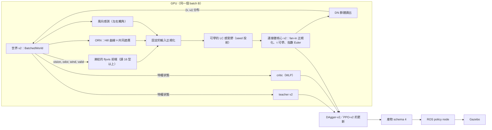
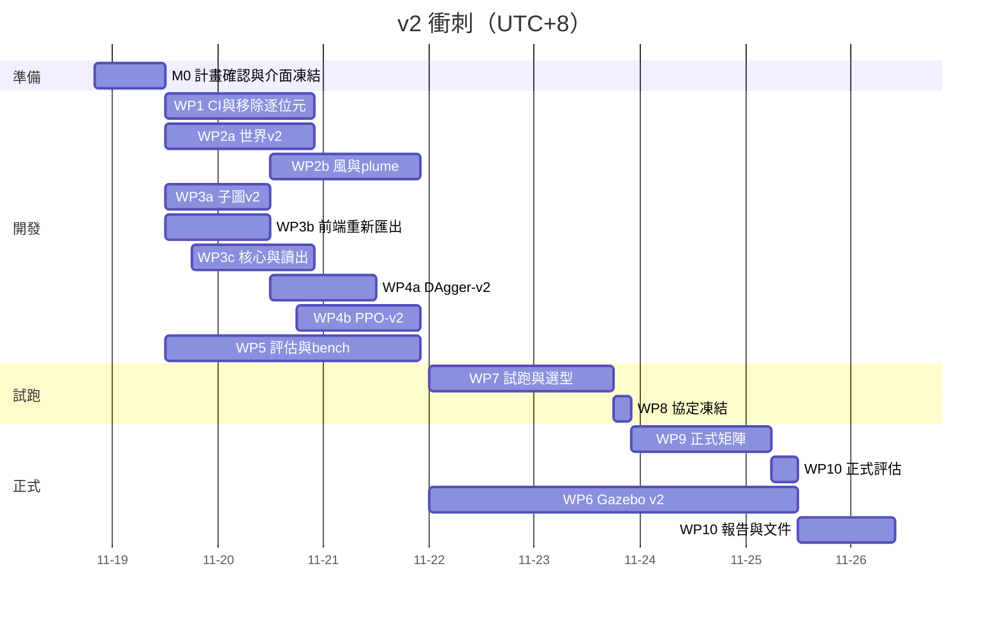

# 大實驗計劃書（v2）

> **狀態：使用者 2026-11-18 已確認（第 7 節 D1–D7 全部同意），依本計畫動工。** 動工後的開發與協作一律照第 5 節。
> - 2026-11-18 晚的修訂：納入 #130 review 的建議，以及之後的 Decision（#137、#145、#148、#152、#153、#154）。修訂只把已經做出的決定寫進來，沒有改變目標、gate 和排程。
> - 2026-11-19 的修訂：寫入外部審查（#161）、#158、#160 的 Decision。內容是引用、用詞、觸角公式、讀出和 PPO 的規格，以及遮蔽的畫法；目標、gate 和排程沒有改變。
> - 分支：`v2`，從 `4304571`（tag `v1-final`）開出；11-18 第一次整合後是 `98beaa5`
> - 總追蹤：[#127](https://github.com/Nues0913/Drosophila_Tracking_System/issues/127)
> - **最終截止：2026-11-26 10:00（UTC+8）**。程式重構、訓練、驗證和結果整理都要在這之前完成。
> - 撰寫：PM（代表 @Nues0913 的 Agent），2026-11-18。時間一律是 UTC+8。

## 摘要

**為什麼要 v2。** formal-v1 有三個問題卡在設計本身，調參解決不了：
1. **前進速度固定**：DNp09 的真實輸入在子圖裡只剩 11.6%，全域譜半徑又把訊號壓到 1e-4 的量級，所以 G3 的 normal 成功率最高只有 0.484。
2. **氣味沒被用上**：plume 不帶方位資訊、世界裡沒有風，BC 也只用 normal 回合。
3. **對照組退化**：GRU、RS 都退化，連接體結構的比較不成立。

另外，訓練很慢：PPO 每秒 239–307 步，2D 模擬有 84% 的時間花在 CPU 的光線投射。而且沒有 CI。

**v2 的四條主線。**
1. **GPU 批次的 2D 世界**：模擬和模型都放在 GPU 上。訓練吞吐量的目標是 v1 的 5 倍以上；硬性下限是不得低於 v1。
2. **納入更多神經元，並改善核心的數值條件**：
   - 子圖改用「型別層級突觸總和」門檻，補回 LC9→DNp09 和 LC10a→AOTU019／AOTU025→DNa02，規模從 4,502 擴大到 8,000–15,000 個神經元。
   - flyvis 前端讀出的型別從 8 個增加到 16 個以上；DN 讀出從 6 顆擴大到整個 DN 群體。
   - 突觸權重改成 fan-in 正規化，不再需要 ×100 的增益補丁；神經時間常數 τ 可以學到秒級。
3. **新的訓練法**：先做全情境混合的 DAgger（長序列＋burn-in），再接 PPO 微調（kickstarting 蒸餾、critic 先暖身、critic 讀特權狀態、上千個平行環境）。
4. **讓氣味有用的世界**（需要你決定，見 D2）：風帶動的 filament plume，加上左右觸角的風向輸入。

**其他。**
- **對照組重新設計**：保留度數與左右側的重接圖、Erdős–Rényi 隨機圖、參數量相同的 GRU，三者都走同一條訓練鏈（仿 FlyGM）。
- **工程**：GitHub Actions CI（lint＋快速測試）、測試分層、效能回歸守門、結構化的訓練監控。**逐位元重試和 deterministic 模式全部移除。**

**時程。**

| 時間（UTC+8） | 里程碑 |
| --- | --- |
| 11-19 | 介面凍結 |
| 11-20 | 各模組合併 |
| 11-21 | 端到端跑通 |
| 11-22～23 | 試跑與選型 |
| 11-23 22:00 | 協定凍結 |
| 11-24～25 | 正式矩陣與評估 |
| 11-26 10:00 | 交付 |

範圍分三級：A 級必做，B、C 級依進度砍（6.4）。

---

## 0. 前提、範圍與盤點方式

### 0.1 前提

- **v1 凍結**：tag `v1-final`、分支 `release/v1`、release `formal-v1`。11-22 的期末交件用 v1（D7）。
- **v2 只在 `v2` 分支開發**，PR 的 base 一律是 `v2`，main 和 release/v1 不受影響（#127、AGENT_TEAM_WORKFLOW 3.1）。
- **v2 可以推翻 v2 之後的所有設計**，包括世界、感覺輸入、子圖、模型、訓練法、評估協定和協作規範（使用者 11-18 授權）。v1 的結論不因 v2 而改變。

### 0.2 排除項

1. **會明顯降低訓練速度或吞吐量的方案，一律不採用。**
   - 量化標準：同一台主機、同樣的 batch，端到端的訓練吞吐量（環境步／秒）不得低於 v1。
   - 個別 PR 讓 bench 退步超過 5%，就不合併（4.3）。
   - 因此 v2 不用以下做法：
     - deterministic CUDA kernel（約慢 2 倍）
     - autograd anomaly detection
     - 每一步都做 `.item()` 或同步寫 log
     - 梯度 checkpointing
     - LIF 或脈衝神經網路的模擬
     - 在訓練迴圈裡做評估
   - **顯存不夠時**（#137 的 Decision）：先用梯度累積，每次更新的總序列數不變。activation checkpoint 只有在 bench 的 (d) 比同一台主機上「跑得動的替代方案」快，或差距 ≤ 5% 時才可以用。兩者都不改變數學，所以每台主機可以各自選，選擇寫進 train 設定和 model card。
2. **逐位元重試全部移除**（清單見 3.14）。
   - 要移除的有：GPU 的 deterministic 模式、`deterministic` 設定、`DETERMINISTIC=1`，以及「重跑後比對逐位元相同」的驗證項。
   - v2 的數值比對一律用容差（`allclose`）或統計（seed 層級的 bootstrap 信賴區間），不要求重跑得到相同的位元。

### 0.3 盤點方式

- **讀過的文件**：README、後續計畫.md（含 #126 新增的問題）、AGENT_TEAM_WORKFLOW.md、docs/status.md、docs/training_time.md、docs/related_work.md。
- **讀過的設定**：configs 底下的 model、train、scenarios、evaluation_protocol、sensor_contract。
- **讀過的程式**：`flytrack_core/model/policy.py`、`frontend.py`、`flytrack_sim/env.py`、`teacher.py`。
- **實測**：PM 的 2060，2026-11-18，腳本放在 `runs/reviews/pm-2026-11-18/v2_plan/`。量了以下三項，結果在 1.4 節：
  - 2D 環境每一步的耗時和 profile；
  - policy 在 CPU 和 GPU、各種 batch 下每一步的耗時；
  - 前端和子圖的規模。

---

## 1. 現況問題診斷清單

### 1.0 v1 的架構

```text
感測（2D 或 Gazebo）
  → 凍結的 flyvis 前端（每眼 45,669 個節點），只讀 T4/T5 的 5 個角度區間
  → ORN 的 Hill 曲線
  → 固定的 LC／ORN seed 投射
  → MaleCNS no-KC 子圖（4,502 個節點）上的 rate 模型
  → 讀出 6 顆 DN
  → 動作 (v, ω)
```

- 訓練鏈：pretrain → BC／DAgger（teacher 使用特權資訊）。
- PPO 是研究用的選項，不在正式鏈裡。

### 1.1 科學與行為

| 編號 | 問題 | 證據 | v2 的處理 |
| --- | --- | --- | --- |
| S1 | **G3 行為未達成**：normal 成功率最高 0.484（2D curved，VO-late）、0.450（Gazebo，V），門檻是 0.8 | 後續計畫 §1 | 3.5–3.8：重做速度通路、讀出和訓練；gate 是 G-A |
| S2 | **前進速度固定**：VO、VO-late 的速度在 0.168–0.179 m/s，目標是 0.200 m/s。normal 的失敗多半是跟在距離門檻外 | 揭露第 18 點、#90 | 3.5 補回 DNp09 的輸入；3.7 速度改由 DN 群體讀出；3.8 的 `track_v2` reward（要待在追蹤範圍內就得跟上速度，沒有單獨的速度項） |
| S3 | **DNp09 的輸入覆蓋率只有 11.6%**：「單一條邊 ≥ 50 個突觸」的門檻，把 LC9→DNp09 整組濾掉了（很多顆細胞，每顆十幾個突觸） | status 11-16、S6 | 3.5 改用型別層級的突觸總和門檻，並要求每個 DN 的輸入覆蓋率 |
| S4 | **訊號被壓小，梯度不夠**。全域譜半徑上限把每個突觸壓到約 2.6e-4，方位訊號到 DN 只剩約 3e-4，只好靠 `motor_input_gain`、`odor_input_gain` 的 ×100 補回來。BC 時型別 bias 的梯度是電導的 30–1000 倍，只能凍結 | `policy.py` 的註解、`configs/model` | 3.6 改成 fan-in 正規化（每顆神經元的輸入總和是 1）。穩定性由 row-sum 上界保證，不需要全域縮小，也不需要 ×100 |
| S5 | **讀出只有 6 顆 DN**：DNa01、DNa02（轉向）和 DNp09（速度），各左右一顆。S4 改讀 134 型 DN，沒有成功 | 1.4 的盤點 | 3.7 改用 DN 群體讀出。要先修好 S4 這個問題，群體讀出才有意義 |
| S6 | **氣味沒被用上**：O 的成功率 ≤ 0.006；VO 拿掉氣味，成功率不變。plume 是目標走過的軌跡，左右濃度差和方位的相關只有 0.17–0.25，濃度幾乎不帶距離資訊（R² ≤ 0.06）。世界裡沒有風，BC 也只用 normal 回合 | 後續計畫 2.2 | 3.3 加入風帶動的 plume 和風向輸入（D2）；3.8 全情境混合訓練；新增 world audit：只看氣味的 teacher 在遮蔽時要能成功 |
| S7 | **記憶太短**：訓練後 τ 的中位數是 50 ms，最長 0.06–0.52 s；BC 的序列是 32 步（1.6 s），遮蔽卻有 30 s。遮蔽時的失敗多半是直線撞牆 | 揭露第 20 點 | 3.6 τ 可以學到 10 s（異質初始化）；3.8 序列改成 64 步加 16 步 burn-in，PPO 使用存下的隱狀態 |
| S8 | **模仿有上限，而且有 imitation gap**：teacher 用特權資訊（遮蔽時也知道目標在哪），學生學不到這種行為 | ADVISOR；R1、M1、T1 | 3.8 遮蔽時改用只看學生觀測的 teacher；PPO 可以超越 teacher |
| S9 | **從 BC 接 PPO 反而變差**：C9–C13 都沒有在兩個 seed 上通過 protocol100。當時是 8 個環境 × 256 步，序列 batch 16 | 後續計畫 2.5 | 3.8 加大 batch（≥ 512 個環境）、critic 暖身、kickstarting、critic 讀特權狀態 |
| S10 | **對照組退化**：GRU 被共用的 ×100 ORN 增益弄到瓶頸飽和；RS 就算保留左右側（R2），成功率也全是 0 | #85、#87、#113 | 3.9 新的對照組走同一條鏈、輸入先正規化；拿來比較之前，先確認對照組學得起來（明顯高於 blind） |
| S11 | **noise 情境對參數很敏感**：同一個 bc_B，兩組雜訊參數的成功率是 77% 對 0% | #9 | 3.11 主要用 0.75×，另外報告 0.5× 和 1.0× 的敏感度 |
| S12 | **視覺輸入只有運動**：前端只讀 T4a–d、T5a–d 共 8 型（每眼 40 個特徵）。LC 的輸入是把角度等分後池化，不是實測的感受野。小物體通路（T2、T3、Tm → LC11、LC10a）沒有用到 | 1.4、揭露第 2 點 | 3.4 讀更多 flyvis 的輸出型別，感受野改成可學的非負權重 |
| S13 | **子圖預算與匯流**：4,502 個節點，超過原計畫的 500–3,000。匯流神經元只有 59 個，主架構只好用晚期融合 | 揭露第 1、21 點 | 3.5 v2 取消 500–3,000 的預算（照實揭露），改用 DN 覆蓋率和時間預算來限制規模 |
| S14 | **世界的近似**：2D 是 2.5D 的光線投射；Gazebo 和 2D 有差異（G0d 修過）；G2 的數字來自舊世界 | 後續計畫 §1、§3 | v2 在 Gazebo 只做 G1 範圍的一致性和延遲（Tier B） |

### 1.2 工程與效能

| 編號 | 問題 | 證據 | v2 的處理 |
| --- | --- | --- | --- |
| E1 | **2D 模擬卡在 CPU**：每步 5.55 ms，84% 花在 `hex_eye.raycast`（NumPy）。正式評估時 GPU 使用率的中位數只有 36% | 1.4、training_time.md | 3.3 改成 GPU 批次世界 |
| E2 | **flyvis 前端是 GPU 上的主要成本**：每眼 45,669 個節點、1,513,231 條邊，每個控制步 5 個子步。在 2060 上 batch 256 每步 73 ms，batch 1024 每步 294 ms，但最後只用到 80 個池化特徵 | 1.4 | 3.4 M0 量過 kernel 後換更快的實作；多讀輸出型別幾乎不增加成本 |
| E3 | **小 batch 時被 kernel 啟動成本主導**：2060 上 batch 1 時 GPU 3.4 ms、CPU 11.7 ms。4070 的 Gazebo 裡，GPU 推論反而比 CPU 慢（21–22 ms 對 11–13 ms） | #110、#126 | 部署用 CPU；GPU 推論試 CUDA Graph（`torch.compile(mode="reduce-overhead")`），量過再決定 |
| E4 | **訓練與評估太慢**：正式矩陣在 4060 花 13.4 h（2 個工作合計約 145 步／秒），4070 花 7.8 h；PPO 單一程序 239／307 步／秒；2D 評估 12,000 回合要 5.34 h | training_time.md | 3.3、3.8；目標是 v1 的 5 倍以上 |
| E5 | **沒有 CI**：repo 裡沒有 `.github/workflows`。324 個測試函式展開成 713 個案例，在 2060 上全部跑完超過 10 分鐘，reviewer 得自己跑 | 後續計畫 §4 | 第 4 節 |
| E6 | **舊旗標太多**：`extra_turn_rows`、`center_turn_bias`、`olfactory_rate_beta`、`readout_turn_bias`、舊公式相容、`legacy` layout 等。很多測試只在確認舊公式逐位元相同；`scripts/diagnostics/` 有 30 支一次性的腳本 | 程式碼 | v2 的新套件不帶舊旗標；v1 程式在 v2 分支上只留給 v1 actor 評估用（3.14） |
| E7 | **逐位元重試**：`enable_deterministic()`、`deterministic:`、`DETERMINISTIC=1`，打開後約慢 2 倍 | `sparse.py`、`evaluate*.yaml` | 使用者決定移除（0.2、3.14） |
| E8 | **程式雜湊讓訓練中不能改程式**：訓練鏈會雜湊 `.py`，跑訓練時改到被雜湊的檔案，結果就失效 | `validation.py` | v2 只記錄 git SHA、dirty 旗標和設定的雜湊 |
| E9 | **contract 可以被略過**：policy node 的 `sensor_contract_json` 是空字串時不比對；world 節點是空字串時直接用預設值 | #126 | WP6：兩端都改成必填 |
| E10 | **缺測試**：回合之間的隱狀態重設、lesion 和 evaluate 的配對，都沒有專門的測試 | 後續計畫 §4 | v2 的介面測試（4.2） |
| E11 | **Gazebo 的 agent 煞車時前傾約 35°**：重心在輪軸正上方，只有後 caster；前傾後車身頂緣離中心 0.21 m，大於判定半徑 0.18 m | #126 | v2 的速度會變化，WP6 加前 caster 或調整重心 |
| E12 | **部署環境**：policy 相機用 best effort，丟幀率沒量過；4070 的 WSL shim 沒寫進文件；ROS 依賴無法完整鎖定；映像不在 registry；權重只放在 GitHub release | #126、後續計畫 §1 | 列為 Tier C；v2 的證據包記錄 image ID（#128 的規範） |
| E13 | **文件追不上進度**：README 和 status 曾經停在舊狀態 | #125 | 5.8：每個里程碑更新 `docs/v2/status.md` |

### 1.3 流程與協作

| 編號 | 問題 | v2 的處理 |
| --- | --- | --- |
| C1 | **review 是瓶頸**：reviewer 要自己跑完整的測試；#126、#128、#129 都在等 MiLong | 4.1 由 CI 代跑；5.5 加入衝刺期的 SLA 和代審規則（D4） |
| C2 | **探索的結果很分散**：S1–S8、T1、M1、R1、R2 分散在多個沒有 PR 的分支 | 5.7 試跑也要開 Issue，輸出格式固定 |
| C3 | **算力協調是臨時決定的**，還有跨主機可比性的限制（#21） | 5.9 列出算力表；同一組比較在同一台主機上跑 |
| C4 | **改正式規格的流程很長**：每一項都要先登記判讀規則 | 登記照舊，但 v2 的判讀規則集中在同一份協定（3.11），M4 一次凍結 |

### 1.4 本次實測的效能基準（2060，2026-11-18）

| 項目 | 數值 |
| --- | --- |
| 2D 環境 `env.step`（單執行緒，開著 profiler） | 每步 5.55 ms（約 180 步／秒）。`_acquire_vision` 佔 84%；300 步裡 `raycast` 本身花了 1.205 s |
| VO policy 每個控制步（`sense`＋核心，不算梯度） | CPU：batch 1 是 11.68 ms。GPU：batch 1 是 3.43 ms，16 是 5.91 ms，256 是 72.87 ms，1024 是 293.83 ms |
| VO-late policy 每個控制步 | CPU：batch 1 是 12.06 ms。GPU：batch 1 是 2.67 ms，16 是 6.17 ms，256 是 78.36 ms，1024 是 317.04 ms |
| VO 算梯度時（GPU，batch 16） | 每步 11.09 ms |
| flyvis 前端（每眼） | 45,669 個節點、1,513,231 條邊、65 個型別。只輸出 T4a–d、T5a–d，每型 5 個角度區間，共 40 個特徵 |
| 中央子圖（正式 no-KC） | 4,502 個節點、31,682 條邊、1,697 個型別。visual 3,263、olfactory 1,722、convergence 59、轉向 DN 4 顆、前進 DN 2 顆（型別是 DNa01、DNa02、DNp09） |
| VO 的可訓練參數 | requires_grad 的有 16,242 個；有效（lr > 0）的有 14,546 個（#77） |

**解讀**：
- batch 從 16 增加到 256，樣本數多 16 倍，每步耗時多 12 倍，GPU 已經接近飽和。
- 所以 v2 的吞吐量上限主要由前端決定。只算前端加核心的推論，2060 大約每秒 3,500 個樣本步，4060、4070 應該更高。
- 這是 v1 PPO 的 10 倍以上，但前提是世界也搬到 GPU：現在的 CPU 世界每個程序只有約 180 步／秒。

---

## 2. 論文與開源庫調研

### 2.1 連接體與果蠅神經科學

| 文獻／資源 | 重點 | 對 v2 的用途 |
| --- | --- | --- |
| [MaleCNS](https://male-cns.janelia.org/)（Berg et al., *Cell* 2026；預印本 doi 10.1101/2025.10.09.680999；v1.0 於 2026-06-08 發布） | 雄果蠅的完整 CNS：166,691 個神經元、11,691 型，授權 CC-BY | 子圖 v2 的來源，用型別層級的突觸總和重新萃取 |
| [flyvis](https://github.com/TuragaLab/flyvis)（[Lappalainen et al., *Nature* 2024](https://doi.org/10.1038/s41586-024-07939-3)） | 連接體約束的視覺系統（六角格），用運動偵測任務訓練，預測結果和 26 篇研究的神經反應吻合 | 前端維持凍結，v2 多讀一些輸出型別 |
| [FlyGM](https://arxiv.org/abs/2602.17997)（Jin et al., arXiv 2026） | 把全腦連接體（139,246 個神經元）當成訊息傳遞圖，用 RL 控制果蠅身體：<br>• 帶號突觸數矩陣固定不學，節點更新是共享的 MLP，每顆神經元有一個可學的描述向量<br>• 先模仿（KL＋退火的 MSE），再接 PPO<br>• 比保留度數的重接圖、ER 隨機圖和 MLP 誤差更低、樣本效率更好 | 對照組的設計（重接、ER、GRU 走同一條鏈）；模仿接 RL 的銜接方式；Tier C 的訊息傳遞核心候選 |
| [Shiu et al., *Nature* 2024](https://doi.org/10.1038/s41586-024-07763-9) | FlyWire 全腦的 LIF 模型 | 不採用 LIF（吞吐量不夠），只當生物上的對照 |
| [Beiran & Litwin-Kumar, *Nat Neurosci* 2025](https://pmc.ncbi.nlm.nih.gov/articles/PMC12648571/) | 連接體常常決定不了動力學，單顆神經元的參數辨識不出來 | 結論只比較「同一條訓練鏈下，連接體結構對上對照組」，不解讀個別參數 |
| [Cowley et al., *Nature* 2024](https://pmc.ncbi.nlm.nih.gov/articles/PMC11136655) | 求偶行為由多種 LC 型別的群體編碼驅動（knockout training） | 視覺輸入改成多種 LC 型別 |
| [Ribeiro et al., *Cell* 2018](https://pubmed.ncbi.nlm.nih.gov/30033367/) | LC10 偏好小的移動物體；單側活化 LC10 會讓雄蠅轉向 | LC10a 列入必要路徑 |
| [Hindmarsh Sten et al., *Nature* 2021](https://www.nature.com/articles/s41586-021-03714-w) | 求偶時 P1 會提高 LC10a 的增益；增益放大後，LC10a 幾乎決定了追蹤 | LC10a 是追蹤的主要輸入 |
| [Collie et al., *Neuron* 2026](https://pubmed.ncbi.nlm.nih.gov/41713413/)（預印本 doi 10.1101/2025.04.23.650240） | LC10a 經 AOTU019（精細轉向）和 AOTU025（粗略轉向）接到轉向 DN | 必要路徑；檢查子圖 v2 是否包含 |
| [Bidaye et al., *Neuron* 2020](https://www.biorxiv.org/content/10.1101/798439.full.pdf) | P9（DNp09）驅動帶同側轉向的前進，是追求所必需；BPN 驅動快速直走 | 讀 DNp09 時同時讀它的轉向成分；速度改由前進 DN 群體讀出（BPN 在 MaleCNS 的對應型別由 WP3a 依連接性找出） |
| [2026 預印本：前進行走的迴路](https://www.biorxiv.org/content/10.64898/2026.01.04.697356.full.pdf) | Roadrunner 神經元和 BPN 組成前進迴路，會招募一群 DN | 速度改由 DN 群體讀出 |
| [Rayshubskiy et al., *eLife* 2025](https://elifesciences.org/articles/102230) | DNa02 負責高增益、短暫的轉向，DNa01 負責低增益、持續的轉向；左右兩側呈 see-saw | 轉向用左右差分讀出，DNa01 和 DNa02 的權重分開 |
| [Braun et al., *Nature* 2024](https://doi.org/10.1038/s41586-024-07523-9) | command-like DN 會招募一整群 DN | DN 群體讀出 |
| [Suver et al., *Neuron* 2019](https://pmc.ncbi.nlm.nih.gov/articles/PMC6533146) | 左右觸角位移的差，是風向（方位角）的線性編碼；WPN 整合兩側 | 風向輸入的感測模型 |
| [Álvarez-Salvado 2018](https://elifesciences.org/articles/37815)、[Demir 2020](https://elifesciences.org/articles/57524)、[Matheson 2022](https://pmc.ncbi.nlm.nih.gov/articles/PMC9360402/) | 果蠅在 plume 中靠風向導航：聞到就逆風前進，失去氣味就搜尋 | 世界 v2 的風；遮蔽時 teacher 的策略 |
| [Farrell et al., 2002](https://apps.dtic.mil/sti/pdfs/ADA399832.pdf) | filament plume：計算便宜，能重現短時間尺度的間歇和蜿蜒 | 世界 v2 的 plume 模型 |
| [Singh et al., *Nat Mach Intell* 2023](https://pmc.ncbi.nlm.nih.gov/articles/PMC10601839/) | 用 RL 訓練的 RNN 在 turbulent plume 中出現類似昆蟲的策略 | 支持「風＋氣味可以被 RL 學到」 |
| [Perez-Nieves et al., *Nat Commun* 2021](https://pmc.ncbi.nlm.nih.gov/articles/PMC8490404) | 可學、而且異質的時間常數，能改善時間性的任務 | τ 的參數化和初始化 |
| [Neuser et al., *Nature* 2008](https://doi.org/10.1038/nature07003) | 物體消失後，果蠅能記住它的方向數秒 | 遮蔽期間記憶的生物依據 |

### 2.2 強化學習與模仿學習

| 文獻／資源 | 重點 | 對 v2 的用途 |
| --- | --- | --- |
| [Rudin et al., CoRL 2021](https://proceedings.mlr.press/v164/rudin22a.html)（legged_gym） | 單張 GPU、4,096 個平行環境：平地不到 4 分鐘學會走路，崎嶇地形 20 分鐘；PPO 的超參數為大規模平行做了調整 | GPU 世界、大 batch 的 PPO |
| [PureJaxRL](https://github.com/luchris429/purejaxrl) | 環境和訓練都放在 GPU：單一 run 約快 10 倍，同時向量化多個 run 可以快上千倍 | 世界和模型放在同一張 GPU；多 seed 向量化列為 Tier C |
| [Andrychowicz et al., ICLR 2021](https://arxiv.org/abs/2006.05990) | 訓練了 25 萬個 agent 做對照：PPO、policy 和 value 分開、輸入正規化、最後一層小初始化、lr 3e-4 線性衰減、γ 0.99、GAE | PPO-v2 的預設值 |
| [Huang et al., 2022：PPO 的 37 個實作細節](https://iclr-blog-track.github.io/2022/03/25/ppo-implementation-details) | 含向量化環境和 LSTM 的實作細節 | 實作檢查表（4.2 的測試） |
| [PIRLNav, CVPR 2023](https://arxiv.org/abs/2301.07302) | BC 初始化後直接做 RL 會崩：要先只學 critic，再逐步提高 actor 的學習率 | PPO-v2 的暖身 |
| [Kickstarting, Schmitt et al. 2018](https://arxiv.org/abs/1803.03835) | RL 損失加上權重逐漸衰減的 teacher 蒸餾項；學生可以超越 teacher | PPO-v2 的蒸餾項 |
| [Asymmetric actor-critic, Pinto et al.](https://arxiv.org/abs/1710.06542) | critic 看特權狀態，actor 只看觀測 | v1 已經在用，v2 保留 |
| [ADVISOR, NeurIPS 2021](https://arxiv.org/abs/2007.12173) | teacher 有特權資訊時，會產生 imitation gap | 遮蔽時的 teacher 只用學生的觀測 |
| [R2D2, ICLR 2019](https://mlanthology.org/iclr/2019/kapturowski2019iclr-recurrent) | 存下隱狀態、加上 burn-in 來訓練遞迴網路 | 長序列的 BC 和 PPO |
| [POPGym, ICLR 2023](https://arxiv.org/abs/2303.01859) | 15 個部分可觀測的環境、13 種記憶模型，GRU 是最穩的通用記憶模型 | GRU 適合當非圖的對照組 |
| [DreamerV3, *Nature* 2025](https://doi.org/10.1038/s41586-025-08744-2) | world model 式 RL，一組設定通吃 150 多個任務 | 不採用（理由見 2.4） |
| [Andy Jones：Debugging RL](https://andyljones.com/posts/rl-debugging.html) | 用極小的 probe 環境，把錯誤定位到單一元件 | 4.2 的 probe 測試 |

### 2.3 工程

| 資源 | 重點 | 對 v2 的用途 |
| --- | --- | --- |
| [uv 的 GitHub Actions 整合](https://docs.astral.sh/uv/guides/integration/github/) | setup-uv 內建快取，以 lock 檔當快取鍵 | CI 安裝依賴 |
| [ros-tooling/action-ros-ci](https://github.com/ros-tooling/action-ros-ci) | 在容器裡跑 colcon build 和 test | ROS 的 CI job |
| [PyTorch：CUDA Graph 與 reduce-overhead](https://pytorch.org/blog/accelerating-generative-ai-4/) | 小 batch 時 kernel 啟動成本佔主導，用 CUDA Graph 可以大幅降低 | 部署推論延遲的實驗（E3） |
| [GitHub Actions 2026 計價](https://resources.github.com/actions/2026-pricing-changes-for-github-actions/) | 私有 repo 的免費分鐘數額度不變；自架 runner 的收費已延後 | CI 要省分鐘：取消重複的執行、用路徑過濾 |

### 2.4 選型與不採用的方案

| 方案 | 決定 | 理由 |
| --- | --- | --- |
| GPU 批次世界（自己用 PyTorch 寫） | **採用** | 2D 的幾何很簡單（牆、圓柱、誘餌），光線投射可以完全向量化；模型本來就是 PyTorch，不必換 JAX |
| 改用 JAX、Brax 或 MJX | 不採用 | 整個 codebase 都要重寫，7 天做不完 |
| NeuroMechFly、flybody 的腿部身體 | 不採用，列為 11-26 之後的方向 | 模擬成本高，而且偏離追蹤和融合的問題 |
| LIF 或脈衝網路（Shiu 2024） | 不採用 | 訓練慢，梯度要用 surrogate，違反吞吐量的限制 |
| FlyGM 式的訊息傳遞核心 | Tier C 候選 | 參數比 rate 模型多很多，每步成本也較高；A、B 級完成後才試 |
| DreamerV3、TD-MPC2 | 不採用 | world model 需要額外的大網路和調參，很難和連接體約束的 actor 結合，時間不夠 |
| SAC 等 off-policy 演算法 | 不採用 | 遞迴網路加上讀特權狀態的 critic，在 off-policy 下要 replay 隱狀態，太複雜；有大量平行環境時 PPO 就夠了 |
| 只加長 BC 的預算 | 不採用 | B1 已經顯示速度問題不是預算造成的 |
| 蒸餾一個小網路取代 flyvis | 不採用，只當備案 | 會改變前端的生物意義。只有 kernel 加速都不夠時才考慮，而且要另外登記 |
| GPU deterministic、逐位元重跑 | **移除** | 使用者的決定；打開後約慢 2 倍 |

---

## 3. v2 架構與神經網路設計

### 3.1 目標（量化）

| 代號 | 目標 | 怎麼量 |
| --- | --- | --- |
| T-1 行為 | VO2 的 normal 成功率 ≥ 0.80（2D；curved 和 wander 分開報告） | 5 個 seed × 100 回合，取 seed 平均 |
| T-2 融合 | 在風世界的遮蔽情境，VO2 − V2 ≥ 0.10，而且 Holm 校正後的單尾 t 檢定顯著 | 配對比較 |
| T-3 結構 | VO2 不比對照組（重接、ER、GRU）差；至少一個對照組不退化（normal 明顯高於 blind） | 不劣性 margin 0.05，另外做優越性檢定 |
| T-4 對照 v1 | 在 v1 相容的世界裡，VO2 的 normal 比 v1 最好的模型（VO-late）高 ≥ 0.10，而且檢定顯著 | 配對比較；v1 的 actor 用 v2 的評估重跑 |
| T-5 吞吐量 | 端到端的訓練吞吐量是 v1 的 5 倍以上；下限 1 倍 | bench（4.3） |
| T-6 延遲 | Gazebo 中，CPU 推論從感測到指令的 p95 < 50 ms（4070） | Tier B |
| T-7 工程 | PR 的 CI < 10 分鐘；v2 的程式裡沒有逐位元相關的程式和測試 | GitHub Actions |

### 3.2 資料流



### 3.3 世界 v2

- **套件與實作**：套件放在 `python/flytrack_v2/world/`。所有狀態都是 `[B, …]` 的 tensor，在 GPU 上一起步進。
- **和 v1 相同的部分**：
  - 10 m 的方形場地，agent 半徑 0.18 m，目標半徑 0.15 m，目標速度 0.20 m/s；
  - 目標運動有 curved 和 wander 兩種，情境有四種；
  - 成功的定義：在目標 2 m 內、方位誤差 45° 內的時間 ≥ 80%，而且沒有碰撞。
- **視覺**：
  - 把 `hex_eye.raycast` 改寫成向量化的射線對圓柱、射線對牆求交，共 2 × 721 個小眼，每個小眼 7 條子射線。
  - 在固定的姿態集上，和 v1 的差要 ≤ 1e-4。比的是容差，不比位元。
  - **float32 的例外**（#158 的 Decision）：子射線剛好擦過交界時，float32 可能翻到另一側。超過 1e-4 的值佔的比例要 ≤ 1e-5，而且每個值的誤差 ≤ 1/7（一條子射線的份量）；float64 則全部 ≤ 1e-4。
- **遮蔽的畫法**（#161 C2、#160 的 Decision）：遮蔽時 `valid` 維持 1。
  - v2 的訓練、試跑和正式評估用 `hide_target`：場景照常 render，只是看不到目標；
  - v1 actor 的一致性稽核，以及拿 v1 actor 比較遮蔽情境的分析，用 `blackout`（formal-v1 訓練時看到的就是全黑影像）。
- **和 v1 的 parity 怎麼做**（#130 的 review、#145）：GPU 世界用自己的隨機流，同一個 seed 也抽不出 v1 `np_random` 的值，所以分兩種：
  - **逐步比對**：把 v1 抽出的隨機量注入 `v1compat`，固定動作，逐步用容差比對觀測、reward、終止和成功判定；
  - **分布比對**：用世界自己的隨機流，比對 audit 的成功率、雜訊的均值和變異數等統計。
- **兩種世界設定**：
  - `v1compat`：沿用 v1 的 puff trail plume，沒有風。用來和 v1 的 actor 配對比較（T-4）。
  - `wind`（D2）：
    - 平均風速 U（候選 0.3–0.5 m/s），風向每回合隨機，用 OU 過程產生蜿蜒；
    - 目標每 0.1 s 釋放一個 filament，filament 隨風平流、隨機擴散，寬度隨時間增加，壽命 20 s，每個環境最多 256 個；
    - 濃度是各 filament 高斯分布的總和（Farrell 2002）。
  - **風向感測**：
    - 照介面契約（`docs/v2/interfaces.md` 第 1 節）：左 = (U / `wind_reference_m_s`) · cos(θ − α)、右 = (U / `wind_reference_m_s`) · cos(θ + α)，θ 是風「吹來的方向」相對頭向的角度（左為正），再加上雜訊；
    - 測試要涵蓋正前、正左、正右、正後四個方向的左右讀值（#161 C1）；
    - 觀測多 2 維 `wind[2]`，有效旗標也多 1 維（Suver 2019）。
- **world audit**（延續 v1，協定凍結前必須通過）：
  - 特權 teacher 的成功率 ≥ 0.9；固定動作的 blind 策略 ≤ 0.1。每個情境都要檢查。
  - **新增**：只看學生觀測、沒有視覺的氣味 teacher，在 `wind` 世界的遮蔽情境成功率要 ≥ 0.5。
    - 沒通過就表示這個世界還回答不了「氣味有沒有用」。
    - 試跑期間可以調整 U 和 filament 的參數。
  - **新增**：在 `v1compat` 世界中，v1 actor 的成功率要和 v1 的正式評估一致（落在 bootstrap 信賴區間內）。
- **效能目標**：1,024 個環境一起步進，每步 ≤ 5 ms（不含模型）。

### 3.4 感覺前端 v2（更多視覺神經元）

- **前端與輸出型別**：
  - flyvis 前端維持凍結，用同一個 checkpoint（`chkpt_00000`）。
  - PM 在 2060 上用本機的 flyvis 1.2.0 重新匯出。flyvis 共有 34 個輸出型別（本機的 connectome 已確認）。
  - v2 先讀其中 16 個：T2、T2a、T3、T4a–d、T5a–d、Tm1、Tm2、Tm3、Tm4、Tm9。v1 只讀 T4a–d、T5a–d 這 8 個。
  - 其餘 18 個（T1、Tm5 系列、Tm16、Tm20、Tm28、Tm30、TmY 系列）要不要加，由試跑決定。
  - 前端本來就會模擬全部 65 型，多讀一些輸出幾乎不增加成本。
- **角度區間**：從 5 個增加到 9 個（每個約 13.3°），所以每眼的特徵是 16 型 × 9 區間 = 144 個。
- **輸入正規化**：
  - 用 100 回合 teacher 軌跡算一次平均和標準差，存進 artifact，之後固定不變。
  - 不用 running statistics，所以部署時不會漂移。
- **LC 的感受野**：
  - 每個視覺 seed 型別都有一組非負、可學的「特徵型別 × 角度區間」權重，同型別、同側的神經元共用。
  - seed 型別以子圖 v2 實際納入的為準，例如 LC9、LC10a、LC11、LC12、LC15、LC17、LPLC2。
  - 預設初始化成 v1 的等分池化。這仍然是工程上的假設，會照實寫進 model card。
  - **限制**（#161 B3）：同一型、同一側的所有 LC 細胞收到相同的外部輸入，沒有逐顆的視野位置。MaleCNS 裡 LC10a、LC9、LC11、LC12 的 `assignedOlHex` 全部是空的，沒辦法直接從標註逐顆重建。這會影響 Collie 等人提出的精細和粗略轉向機制，報告要照實寫。逐顆感受野列入附錄 B。
- **氣味**：
  - ORN 的 Hill 曲線和共同適應保留（v1 的 P2）。
  - 拿掉 `odor_input_gain` 的 ×100，改用上面的固定正規化。
- **風**：兩個觸角通道接到風通路的 seed（3.5）。
- **效能**：
  - 前端已經用 int32 的 CSR（#110）。
  - M0 量測三種 kernel：torch CSR、gather＋`index_add`、fp16 CSR。
  - 選最快、而且和 fp32 參考值的差 ≤ 1e-3 的那一種。

### 3.5 子圖 v2（更多中央神經元）

- **來源**：從 MaleCNS v1.0 重新萃取，`connectome_extract` 加入新規則。
  - 原始資料（約 1.11 GB）已經在 PM 的 2060 上（`data/raw/`）；
  - 其他主機要重新下載，不需要 token。
- **門檻改成型別層級的突觸總和**。保留一條邊 i→j 要同時符合兩個條件：
  - i 的型別到 j 的型別，突觸總數 ≥ T_type（候選值 50）；
  - 單一條邊 ≥ T_edge（候選值 3–5，用來濾掉雜訊）。

  **實際採用**（#153）：T_type 50、T_edge 10。T_edge 5 時，試過的 hop 組合邊數都超過 200,000；T_edge 10 時，LC9→DNp09 仍然保留 89% 的突觸。型別對的突觸總和只算單條 ≥ T_edge 的邊，比上面的寫法更嚴。結果是 8,598 個節點、182,678 條邊，DNp09 的輸入覆蓋率左側 0.499、右側 0.402（右側靠補救剛好過 0.40）。

  v1 的規則則是單一條邊 ≥ 50。
- **DN 輸入覆蓋率**：每個運動 DN 在子圖內的輸入突觸，除以它在全腦的輸入突觸，要 ≥ 40%。不到就擴大上游的搜尋範圍。v1 的 DNp09 只有 11.6%。
- **必須包含的路徑**（萃取後由 `verify_subgraph` 檢查，缺了就算失敗）：
  - LC9 → DNp09；
  - LC10a → AOTU019 或 AOTU025 → DNa02；
  - LC11、LC12 的下游接到 DN；
  - ORN → PN → LH → DN（不含 KC，延續 #55）；
  - 風：JO-C、JO-E 的下游（AMMC、WED、SAD 的二階神經元）接到 DN（D2 同意時才需要）。
    - MaleCNS 裡有 JO-CA1、JO-CL、JO-ED1、JO-EV1 等型別，但沒有文獻裡 APN2、APN3、WPN 這些名稱。
    - WP3a 要依連接性找出對應的型別。
- **已確認存在的型別**（MaleCNS v1.0 的 annotation，本機核對）：
  - LC9 219 顆、LC10a 275 顆、LC11 143 顆、LC12 498 顆、LC15 126 顆、LC17 353 顆、LPLC2 185 顆；
  - AOTU019、AOTU025 各 2 顆；
  - DN 共 241 型、671 顆。
- **DN 群體**：所有和追蹤有關、左右成對的 DN 型別。至少包括 DNa01、DNa02、DNa03、DNp09、DNb05（各 2 顆）；前進 DN 群體以萃取結果為準。
- **規模**：
  - 節點 8,000–15,000，邊 ≤ 200,000。
  - 時間預算：核心每步的成本 ≤ 前端的 20%。
  - v1 的 500–3,000 預算取消，照實揭露。
- **號誌**：ACh 為正，GABA 為負，Glu 為負（沿用 v1 的假設，並揭露）。號誌不明的神經元照 v1 的規則處理，並列出數量。
- **產物**：放在 `data/subgraphs/v2_<名稱>/`，內容是 graph.npz、manifest、覆蓋率報表和萃取設定。產物進 git，大小上限 20 MB。

### 3.6 中央核心 v2

神經元 i 的型別記為 t(i)。

```text
τ_t(i) · dv_i/dt = −v_i + b_t(i) + Σ_j W_ij · r_j + I_i
r_j  = softplus_β(v_j)                         （全部神經元，β = 10）
W_ij = s_j · (n_ij / N_i) · g[t(j) → t(i)]
```

- **符號**：
  - s_j 是突觸前神經元的號誌（±1）；
  - n_ij 是突觸數；
  - N_i = Σ_j n_ij 是神經元 i 在子圖內的總輸入突觸數（fan-in 正規化）；
  - g 是每個型別對一個可學的增益，用 softplus 參數化所以 ≥ 0，在型別對之間共享，和 v1 一樣是 flyvis 式的參數共享。
- **激活函數**：v1 的非 DN 神經元用 ReLU，會讓神經元永久沉默、梯度斷掉。v2 全部改用 softplus。
- **穩定性**：
  - 每一列 |W| 的總和等於 g。初始化 g = 0.9 時，ρ(|W|) ≤ max_i Σ_j |W_ij| = 0.9 < 1。
  - softplus 是 1-Lipschitz，所以遞迴不會發散。
  - **這個保證只在初始化時成立**（#130 的 review）：g 用 softplus 參數化時沒有上限，訓練後 g > 1 就不再保證。所以另外提供 `bounded`：g = g_max · sigmoid(θ)，g_max 0.97，任何參數值都保證列和 ≤ 0.97。兩種參數化是試跑的參數（3.10）。
  - 子圖內沒有輸入的神經元（N_i = 0，只有 sensory seed，共 116 個）那一列是 0。
  - 不需要 v1 的全域譜半徑壓縮，也不需要 ×100 的 DN 增益。
- **τ**：
  - τ_t = τ_min + softplus(θ_t)，τ_min = 10 ms。
  - 初始化在 20 ms 到 2 s 之間對數均勻（異質，Perez-Nieves 2021），上限 10 s。這是**模型的有效時間常數**，不代表果蠅神經元的膜時間常數。
- **fan-in 的解讀**（#161 B4）：分母用子圖內的輸入，所以保留下來的輸入，相對權重會被放大（DNp09 約左 2.00 倍、右 2.49 倍）。學到的權重不能直接解讀成果蠅的突觸增益。
- **積分**：
  - 用指數 Euler：v ← v · e^(−Δt/τ) + (1 − e^(−Δt/τ)) · (b + W r + I)，對任何 τ 都穩定。
  - 每個控制步 5 個子步（Δt = 10 ms，和前端一致）。
- **bias**：可學，但學習率是其他參數的 0.1 倍。
  - v1 的 bias 梯度是電導的 30–1000 倍，只好凍結。
  - fan-in 正規化之後可以重新試，由試跑決定。
- **實作**：
  - 用 int32 CSR 做稀疏乘法。
  - 核心和前端分開。前端輸出的感覺碼在 rollout 時算一次，存起來給訓練重複使用（v1 已經這樣做）。

### 3.7 讀出 v2

- **轉向**：ω = ω_max · tanh(Σ_k a_k · (r̄_{k,L} − r̄_{k,R}) + c)。
  - k 是所有成對的轉向相關 DN 型別，包括 DNp09 的轉向成分；
  - r̄ 是同型別、同側神經元的平均活動。
- **速度**：v = v_max · sigmoid(Σ_m b_m · (r̄_{m,L} + r̄_{m,R}) + d)。
  - m 是前進 DN 群體；
  - d 的初始值讓速度從 0.2 m/s 開始。
- **讀出偏置的校準**（#161 A1）：c、d 在「零輸入演化到穩態」之後校準（例如零輸入演化 8 s 後，v = 0.20、ω = 0），不是在初始狀態校準。否則寬版的讀出沒有任何感覺輸入也會自己加速。模型測試：零輸入 8 s 後的速度漂移 ≤ 0.01 m/s。
- **雙側 DN 群體讀出**（#161 A2，試跑的參數）：子圖裡一左一右、兩顆輸入覆蓋率都 ≥ 0.40 的 DN 型別。清單用 bodyId 固定在 `configs/v2/model/`，試跑前 commit。
- **動作分布**：在 tanh 和 sigmoid 之前加上高斯雜訊（log std 和狀態無關），和 v1 的 PPO 一樣做機率轉換。
- **可以拿掉的舊設計**：DNb05 的特製轉向列（v1 的 B3）、`readout_turn_bias`、`extra_turn` 系列的旗標。

### 3.8 訓練 v2

**Stage 1：DAgger-v2（A 級，必做）**

- **資料混合**：
  - 情境：normal 40%、occlusion 25%、noise 20%、conflict 15%；
  - 世界：`v1compat`、`wind` 各一半（#161 D4）；
  - 目標運動：curved 和 wander 各一半。
- **teacher v2**：
  - 看得到目標時：沿用 v1 的特權 teacher。
  - 遮蔽時：只用學生的觀測（風和左右的氣味），做逆風前進和橫風搜尋，速度維持遮蔽前的估計值。這樣 teacher 示範的是學生做得到的行為（ADVISOR）。
- **DAgger 的輪次**：
  - 共 4 輪，β（使用 teacher 動作的機率）依序是 1.0、0.5、0.25、0；
  - 每輪 0.75M 環境步，共 3M。
- **最佳化**：
  - 序列 64 步（3.2 s），前面加 16 步 burn-in，從存下的隱狀態開始（R2D2）；
  - batch 256 條序列；
  - Adam，lr 從 1e-3 以 cosine 降到 1e-4；
  - 梯度裁剪 1.0，活動正則 1e-4。
- **損失**：teacher 動作的高斯負對數似然，log std 也一起學。
  - teacher 的動作先用介面的 `unsquash`（ε = 1e-6）轉回潛在變數。標籤常常貼在動作上限，訓練端可以再往內縮一個 margin，寫進 train 設定（#145 的 Decision）。
- **顯存**：4060 用「不開 checkpoint、2 × 128 累積梯度」；2060、4070 各自實測後選（#137 的 Decision）。

**Stage 2：PPO-v2（B 級）**

- **起點與規模**：
  - 從 Stage 1 的結果開始；
  - 每次更新用 1,024 個環境 × 32 步，共 32,768 個樣本，跑 4 個 epoch、8 個 minibatch。
- **非對稱的 actor-critic**：critic 是 MLP，讀特權狀態（目標的相對位置與速度、遮蔽旗標、風）；actor 只看觀測。
- **PIRLNav 式的暖身**（時程用 actor 的更新次數定義，#161 D2）：
  - 前 N_c 次更新只訓練 critic（試跑用 20 次）；
  - 接下來 20 次更新，actor 的學習率從 0 線性升到 3e-4，之後再線性衰減；
  - 記錄實際的 actor 更新次數、學習率、KL，以及 held-out 的配對差。
- **kickstarting**（#161 D1）：
  - 損失加上 λ_t · KL(π_teacher ‖ π_θ)；
  - **teacher 用凍結的 Stage 1 策略**（和 actor 同一種高斯分布，所以 KL 是有限值）；PPO 階段不再用特權 teacher 的動作；
  - λ 在 actor 更新的前 30% 內，從 1 線性降到 0。
- **reward**（命名為 `track_v2`，和評估的成功判定對齊，#161 D3）：
  - 世界的 `reward: v1` 只給 parity 測試用；
  - 在追蹤範圍內（2 m 內、45° 內）的每一步 +1；
  - 距離項 +0.3 · (3 − min(|d − 1 m|, 3 m))，也就是誤差上限算到 3 m，每個沒有碰撞的步驟都 ≥ 0；
  - 碰撞 −10，並結束回合。碰撞的那一步沒有 +0.9 的存活項，其他各項照算：reward = 追蹤 − 0.3 · min(|d − 1 m|, 3 m) − 10 − 0.05 · |Δa|（#181 的實作）；
  - 動作變化 −0.05 · |Δa|。
  - 為什麼距離項要加常數（#161 2026-11-19 的 Decision）：原本的 −0.3 · min(|d − 1 m|, 3 m) 在跟丟時每一步都是負的，最低 −0.9。用 γ = 0.99 折扣，跟丟之後提早撞牆反而比較划算，PPO 可能學到「跟丟就去撞牆」。加常數之後，每個活著的步驟都 ≥ −0.05 · |Δa|，所以撞牆的那一步一定比安全停住的一步差；固定軌跡測試在 γ = 0.95、0.99、0.999 都是停下比較好（γ 非常小時，煞車的動作變化扣分可能讓順序反過來，#181 的 review）。三項之間的相對大小不變。時間截斷要 bootstrap，不能當成終止。
  - 固定軌跡的測試：
    - 同一條路徑，在牆前 0.5 m 停下，要比撞上去的總回報高，γ = 0.95、0.99、0.999 的折扣回報也都要更高；
    - 持續追上要比常速落後（0.12 m/s）的總回報高。
- **其他超參數**：γ 0.99、GAE λ 0.95、clip 0.2、target KL 0.02、value 係數 0.5、entropy 0.001、梯度裁剪 0.5；觀測用固定的統計正規化；advantage 也做正規化。
- **預算**：每條鏈 10M 環境步。估計在 4060 上約 1 小時，M2 實測後修正。
- **取代 Stage 1 的條件**：Stage 2 的 held-out 成功率不能比 Stage 1 差，才用 Stage 2 的結果。這條 gate 會寫進協定。

### 3.9 變體與對照組 v2

正式矩陣是 6 個變體 × 5 個 seed，和 v1 一樣是 30 條鏈。

| 變體 | 內容 | 用途 |
| --- | --- | --- |
| VO2 | 子圖 v2，視覺＋氣味（＋風） | 主要模型 |
| V2 | 同一張圖，只開視覺 | 融合比較的基準 |
| O2 | 同一張圖，只開氣味和風 | 確認氣味通路可以單獨追蹤 |
| RW2 | 重接：保留每顆神經元的入度、出度、號誌、型別對標籤和左右側（只在同一側之間交換） | 結構的對照組，修正 v1 RS 打亂左右側的問題 |
| ER2 | Erdős–Rényi：節點數、邊數和號誌比例相同，型別對標籤照原本的分布抽 | 結構的對照組 |
| GRU2 | GRU，隱藏層大小讓有效參數落在 VO2 的 ±5%，輸入一樣先固定正規化 | 非圖的對照組（POPGym） |

- 所有變體都走同一條 Stage 1（加上 Stage 2）的訓練鏈，步數和超參數也相同。
- VO-late、RS 和 v1 的 GRU 不進 v2 的矩陣；v1 的結果留在 formal-v1。

### 3.10 超參數策略

- **seed**：
  - 試跑用 100、101；正式用 0–4。
  - 評估回合的 seed 和訓練的 seed 完全分開（沿用 v1）。
- **調參只在試跑期間做**：
  - 每次 sweep 最多 4 組；
  - 選擇規則事先寫在 Issue 裡：選試跑 seed 的 held-out（normal＋occlusion）平均成功率最高的那一組。
- **正式矩陣開始後不再調參**；正式評估的情境和回合也不拿來選參數。
- **可以調的只有以下幾項**，預設值見 3.8：
  - lr：3e-4、1e-3；
  - 序列長度：64、128；
  - bias 學習率的比例：0、0.1；
  - kickstarting 的 λ 退火比例：0.3、0.5；
  - 風速 U（只在試跑期間）：0.3、0.5；
  - g 的參數化：softplus、`bounded`（#154）；
  - 速度讀出：只用 DNp09，或雙側 DN 群體（#154、#161 A2；v1 的 S2 就是速度只靠 DNp09）。
  - WP7 的 4 組就是 g 的參數化 × 速度讀出（#161 A4）。

### 3.11 評估 v2 與 gate（草案）

M4 時凍結到 `configs/v2/evaluation_protocol.yaml`（schema 4）。

**評估設定**

- 情境：
  - normal；
  - occlusion：8 s 開始，持續 30 s；
  - noise：主要用 0.75×，另外報告 0.5×、1.0× 的敏感度；
  - conflict。
- 目標運動：curved（主要）、wander（次要）。
- 世界：`v1compat` 和 `wind`。
- 每個組合（變體、seed、情境、運動、世界）跑 100 回合，用 GPU 批次評估。
- 統計方法（#152 的 Decision）：
  - 先在每個 seed 內對回合取平均；
  - 配對比較依訓練 seed 配對，使用同一組回合 seed；
  - **p 值用單尾配對 t 檢定**（自由度 n − 1），預先登記的比較做 Holm 校正，α = 0.05；
  - 報告 95% 的 t 區間，bootstrap 區間一起報告，但不用來判定。只有 5 個 seed 時，bootstrap 的檢定太寬鬆（模擬的偽陽性率約 12%）；
  - `reacquisition_time_s` 同時報告截尾比例和受限平均時間。

**判定（草案）**

| Gate | 內容 |
| --- | --- |
| G-A（行為） | VO2 在 `v1compat` 和 `wind` 兩個世界的 curved normal 成功率都 ≥ 0.80 |
| G-B（融合） | `wind` 遮蔽情境，VO2 − V2 的點估計 ≥ 0.10，而且 Holm 校正後的單尾 t 檢定 p < 0.05 |
| G-C（結構） | VO2 對 RW2、ER2、GRU2 不劣（margin 0.05），優越性另外報告。對照組要先通過「不退化」檢查（normal 成功率 ≥ 0.3）才拿來比較 |
| G-D（相對 v1） | 在 `v1compat` 的 curved normal，VO2 − v1 的 VO-late 的點估計 ≥ 0.10，而且 Holm 校正後的單尾 t 檢定 p < 0.05 |
| G-E（工程） | 吞吐量 ≥ v1（硬性）；CI 全綠 |

- **formal-v2 的條件**：G-A 和 G-E 都通過、而且使用者同意，才打 `formal-v2` 的 tag，並把 v2 合回 main。
- 其他 gate 不論結果如何，都照實報告。
- **再現性**：用同樣的設定重跑，成功率落在原本的信賴區間內就算再現，不要求位元相同。

### 3.12 部署（ROS／Gazebo，B 級）

- **model card**：schema 4（`spec_version: "v2"`）。載入時核對雜湊、步長、幾何和形狀，不符就拒絕（延續 v1）。
- **policy node**：支援 v2 模型和風向 topic（D2 同意時）；contract 改成必填。
- **world node**：plume 和風改用 `flytrack_v2.world` 的實作；contract 改成必填。
- **車體**：加前 caster 或調整重心（E11）。
- **驗收**：
  - VO2、V2 在 G1 範圍的 48 回合，行為要和 2D 一致；
  - 在 4070 上，CPU 推論的延遲 p95 < 50 ms。延遲要在 4070 **沒有其他工作**時量（#110 的條件），這個條件寫進證據包（#130 的 review）。
- **不做**：完整的 G2 矩陣，時間不夠，留到 11-26 之後。

### 3.13 預期效益與主要風險

| 問題 | v2 的機制 | 預期 |
| --- | --- | --- |
| S1、S2、S3、S5（速度固定） | 補回 DNp09 的輸入、DN 群體讀出、fan-in 正規化、PPO 的 `track_v2` reward | 速度在回合內會變化；normal 成功率接近 G3 的 0.8 |
| S4（訊號太小） | fan-in 正規化和 row-sum 上界 | 不需要 ×100 的補丁；梯度量級合理 |
| S6、S8（氣味） | 風世界、風向輸入、只看觀測的遮蔽 teacher | 只看氣味的 teacher 通過 audit；VO2 的遮蔽成功率高於 V2 |
| S7（記憶） | τ 可學到秒級、長序列、burn-in | 遮蔽期間不再直線撞牆 |
| S9（PPO） | 大 batch、暖身、kickstarting | PPO 不會讓 BC 的結果變差，甚至能改善 |
| S10（對照組退化） | 新的對照組和正規化的輸入 | 對照組不退化，結構的比較有意義 |
| E1、E2、E4（速度） | GPU 世界、更快的 kernel | 吞吐量是 v1 的 5 倍以上 |
| E5（沒有 CI） | CI 和測試分層 | review 不必再自己跑完整的測試 |

主要風險和對策見 6.5。

### 3.14 移除與保留

**移除：逐位元重試**

- `python/flytrack_core/model/sparse.py`：刪掉 `enable_deterministic()` 和 deterministic 分支，`spmm` 直接用 `torch.sparse.mm`。
- `python/flytrack_train/evaluation.py`：刪掉 `deterministic` 選項。
- `configs/train/evaluate*.yaml` 和 `docs/teacher/issue24/*.yaml`：刪掉 `deterministic:`。
- `scripts/diagnostics/policy_episode_eval.py`：刪掉 `DETERMINISTIC=1`。
- 測試：
  - 刪除 `test_deterministic_spmm_matches_cusparse_and_repeats_bitwise`；
  - 其他「重跑或恢復後逐位元相同」的測試（例如 `test_ppo_candidate.py` 的 bitwise recovery），改成容差比對，或直接刪除。
- 文件：
  - 刪除後續計畫.md §4「評估在 GPU 上不是逐位元可重現」這一列，以及 lesion 那一列裡的 `enable_deterministic()`；
  - 刪除 TRAIN_NOTES 裡的相關說明。

**保留**（不屬於逐位元重試）：產物的 SHA-256 檢查碼；`deterministic_npz` 的穩定序列化。這兩者不需要重跑比對，也不影響速度。

**v1 程式在 v2 分支的處理**

- `flytrack_core`、`flytrack_sim`、`flytrack_train` 都保留，但只用來評估 v1 的 actor 和產生 v1 的基準，不再加功能。
- v1 的舊旗標相容測試標成 `legacy`，只在 `full` 跑（每次合併進 v2）。
- v2 的程式放在新的套件 `python/flytrack_v2/`，不帶任何舊旗標。

---

## 4. CI 與除錯流程

### 4.1 GitHub Actions

| workflow | 觸發 | 內容 | 時間目標 |
| --- | --- | --- | --- |
| `ci.yml` 的 lint | PR 到 v2 或 main、push 到 v2 | `ruff check`、`ruff format --check` | 1 分鐘 |
| `ci.yml` 的 test-fast | 同上；只改文件的 PR 略過 | 用 CPU 版的 lock 安裝（setup-uv 快取），跑 `pytest -m "not slow and not gpu and not ros and not legacy and not bench" -n auto` | < 8 分鐘 |
| `ros.yml` | 改到 `ros2_ws/`、`docker/`、`compose*` | 在 ROS 容器裡跑 colcon build 和 test | < 15 分鐘 |
| `full.yml` | 每次合併進 v2 | 跑全部的 CPU pytest（含 slow、legacy）；之後加上 v2 在 CPU 上的小型端到端（1 個環境、200 步） | < 30 分鐘 |

- **省分鐘**：同一個 PR 有新的 push 時，取消舊的執行（concurrency）。
- **為什麼不是 nightly**：GitHub 只從預設分支（main，內容是 v1）觸發排程，所以改成每次合併進 v2 時跑全套（#148）。
- **CPU 版 lock**：新增 `requirements/ml-cpu-py312.lock`（CPU 版 torch，只給 CI 用），避免每次都下載 CUDA wheel。
- **必要檢查**：lint 和 test-fast；改到 ROS 時加上 ros。
  - 要在 GitHub 設定 v2 的 branch protection 和 required checks。我的 token 沒有權限，需要你操作（D5）。
- **GPU 測試不在 CI 跑**：作者在本機跑 `pytest -m gpu`，把 log 貼在 PR；PM 在 2060 上抽查。
- **本機的等效檢查**：`scripts/v2/check.sh`（lint 加快速測試），送 PR 前先跑。

### 4.2 測試分層

| 標記 | 定義 | 在哪裡跑 |
| --- | --- | --- |
| （無標記） | < 5 秒，只需要 CPU | 每個 PR |
| `slow` | ≥ 5 秒 | `full` |
| `gpu` | 需要 CUDA | 作者本機 |
| `ros` | 需要 ROS | `ros.yml` |
| `legacy` | v1 程式的相容測試 | `full` |
| `bench` | 效能量測 | 手動（4.3） |

v2 必備的測試：

- **介面**：
  - actor 只接收 obs；
  - 回合邊界會重設隱狀態：同一個 seed 連跑兩回合，第二回合要和單獨跑時一樣（容差比對）；
  - 載入 artifact 時會核對；
  - contract 必填。
- **世界**：
  - 把 v1 抽出的隨機量注入 `v1compat`，給定固定的動作序列，觀測、reward、成功判定要和 v1 env 一致（容差比對）；另外用世界自己的隨機流做分布比對（3.3）；
  - world audit 的小規模版本。
- **核心**：
  - row-sum 上界：初始化時 ≤ 0.9；`bounded` 在隨機的參數值下也 ≤ g_max；
  - τ 在設定的範圍內；
  - 指數 Euler 在 τ → 0 和 τ → ∞ 時的極限正確；
  - 稀疏和稠密的實作結果一致（容差比對）。
- **訓練**：
  - BC 能 overfit 單一個 batch；
  - PPO 的 probe 環境：常數 reward 下 value 要學對、reward 由觀測決定、需要記憶的延遲 reward；
  - loss 和梯度都是有限值；
  - 每個參數群組都收到非零的梯度。
- **評估**：bootstrap 和配對比較的數值，用已知答案的小例子驗證。

### 4.3 效能回歸守門

- **`scripts/v2/bench.py`**：用固定的設定量四項，輸出 JSON（含主機、GPU、commit）：
  - (a) 世界的步進；
  - (b) 前端加核心的推論；
  - (c) 一次完整的訓練更新；
  - (d) 端到端每秒的環境步數。
- **M0 的基準**：三台主機各量一次 v1 的基準（v1-final 的 BC rollout 和 PPO），以及 v2 的初版。
- **PR 的規則**：
  - 改到熱路徑（world、model、train）的 PR，作者要附上同一台主機改前、改後的 bench JSON；
  - (d) 退步超過 5% 就不合併，除非 PM 和使用者另外核准。
- **正式矩陣**：訓練吞吐量寫進證據包。

### 4.4 訓練中的監控與快速失敗（不拖慢訓練）

- **記錄的時機**：每次更新寫一行 JSONL，同時寫 TensorBoard；不是每一步都寫。
- **記錄的內容**：
  - 各項 loss、KL、clip fraction、explained variance、entropy；
  - 各參數群組的梯度範數；
  - DN 的活動（平均值、沉默的比例）和 τ 的分布；
  - 動作飽和的比例；
  - 回合成功率和碰撞率的移動平均；
  - 每秒的環境步數。
- **不拖慢訓練的做法**：所有統計都在 GPU 上累積，每次更新只同步一次。
- **快速失敗**：
  - loss 或梯度出現非有限值：存下這個 batch 和 checkpoint，以 exit code 3（工程失敗）停止。
  - KL 連續 3 次大於 4 倍的 target：停止並標記。
- **階段交界的健康檢查**（取代 dn_health 的一次性腳本）：
  - DN 沒有沉默；
  - 回合內的速度有變化：標準差 > 0.02 m/s，直接檢查 S2；
  - 左右交換氣味時的 |Δω|，延續 v1 的模態檢查。
- **profile**（只在需要時開）：`--profile 50` 會在 50 次更新期間開 `torch.profiler`；CPU 端用 py-spy。

### 4.5 除錯流程

| 症狀 | 先查 | 常見原因 |
| --- | --- | --- |
| loss 變成 NaN | 快速失敗時存下的 batch；τ 和 g 的範圍 | lr 太大、τ 太小 |
| PPO 一開始就變差 | critic 暖身有沒有完成、explained variance | 跳過了暖身、critic 太弱 |
| KL 暴增 | lr、advantage 正規化、minibatch 大小 | lr 太大、batch 太小 |
| 速度固定 | 健康檢查的速度標準差、前進 DN 的活動 | DN 沉默、讀出飽和 |
| 遮蔽時撞牆 | τ 的分布、遮蔽期間的 DN 活動 | 記憶太短 |
| 氣味沒有用 | 氣味 teacher 的 audit、模態檢查 | 世界沒有給資訊、讀出沒學到 |
| 吞吐量下降 | bench 的 (a)–(c) 分項、profiler | 不必要的同步、CPU 和 GPU 之間的複製 |

診斷的結果寫進 PR 或 Issue：一則留言，寫出結論，不貼原始 log。

### 4.6 不做的事

- 不做 deterministic 模式，也不做逐位元的重跑比對。
- 不在訓練迴圈裡做評估或畫圖。
- 不開 autograd anomaly detection。

---

## 5. 新版分工與協作規範（v2）

### 5.1 適用範圍與優先順序

- **適用範圍**：
  - 所有 base 是 `v2` 的 Issue 和 PR，以及 v2 的實驗與交付；
  - 期間從使用者確認本計畫開始，到 11-26 10:00 為止（衝刺期）。之後由 PM 改寫成常態版。
- **和 AGENT_TEAM_WORKFLOW.md 衝突時**：v2 的工作以本節為準；main 和 release/v1 仍照原規範。本節沒寫到的，照原規範。
- AGENT_TEAM_WORKFLOW 的 3.1 會加一行，指到本節（在 #128 之後的 PR 裡加）。

### 5.2 角色與模組主責

| 成員 | 角色 | v2 的主責 | 主機 |
| --- | --- | --- | --- |
| @Nues0913（PM，含代表他的 Agent） | 架構、協定、整合、合併 | 計畫與協定、介面契約、`flytrack_v2/eval/`、bench、CI、文件；flyvis 重新匯出（由 MiLong 審） | 2060 |
| @MiLong9487 | 模型與訓練 | 子圖 v2 的萃取、`flytrack_v2/model/`、`flytrack_v2/train/`、正式訓練 | 4060 |
| @cweiting731 | 世界與部署 | `flytrack_v2/world/`、teacher v2（和 MiLong 共同審查）、ROS／Gazebo v2、docker、ROS 的 CI | 4070 |

| 路徑 | 主責 | 必要的 reviewer |
| --- | --- | --- |
| `python/flytrack_v2/world/`、`configs/v2/world*.yaml` | cweiting | MiLong（只要影響訓練的資料分布）、PM |
| `python/flytrack_v2/model/`、`data/subgraphs/v2_*`、`configs/v2/model*.yaml` | MiLong | PM |
| `python/flytrack_v2/train/`、`configs/v2/train*.yaml` | MiLong | PM |
| `python/flytrack_v2/eval/`、`scripts/v2/bench.py` | PM | MiLong |
| `configs/v2/sensor_contract.json`、`configs/v2/evaluation_protocol.yaml`、`docs/v2/` | PM | 兩位 |
| `.github/workflows/`、`requirements/` | PM | 兩位 |
| `ros2_ws/`、`docker/`、`compose*.yaml` | cweiting | PM |
| v1 套件（只刪逐位元相關的程式） | PM | MiLong |

### 5.3 介面契約（M0 凍結）

M0 之後要改契約，須有 PM 的 Decision，並經兩位 reviewer 審查。

1. **感測契約 v2**（`configs/v2/sensor_contract.json`）：
   - 觀測：`vision [B,2,721]`、`odor [B,2]`、`wind [B,2]`、`valid [B,4]`（左眼、右眼、氣味、風）；
   - 控制 20 Hz，神經步長 10 ms；
   - 動作 `[B,2]`：v（m/s）、ω（rad/s）。
2. **世界**：
   - 建立：`BatchedWorld(config, num_envs, device)`；
   - `reset(mask) -> obs`；
   - `step(action) -> obs, reward, terminated, truncated, info`；
   - `privileged() -> dict`：只給 teacher、critic 和評估使用。
3. **模型**：
   - `initial_state(B)`；
   - `forward(obs, state, reset_mask) -> (dist_params, new_state, aux)`；
   - `sense()` 和 `forward_code()` 分開，讓感覺碼可以快取；
   - actor 讀到 obs 以外的東西，測試就失敗。
4. **產物 schema 4**：`weights.pt`、`graph.npz`、`frontend.npz`、`input_norm.npz`、`sensor_contract.json`、`model_card.json`（`spec_version: "v2"`、`schema_version: 4`）、`SHA256SUMS`。
5. **評估輸出**：逐回合的 JSONL（欄位固定）加上 summary JSON，欄位定義寫在 `docs/v2/metrics.md`。

### 5.4 Git、分支與 commit

- **分支**：
  - 命名：`feat|fix|perf|test|ci|docs/v2-<issue>-<主題>`；
  - 從最新的 `v2` 開分支，PR 的 base 是 `v2`。
- **禁止的操作**：直接 push 到 `v2`、`main`、`release/v1`；force push；`git add -A`。
- **PR 的大小**：
  - 一個 PR 只做一件事；
  - diff（不含測試和資料）建議 ≤ 400 行；
  - 大的工作拆成一串依序合併的 PR。
- **訊息**：
  - commit message 用英文祈使句；
  - PR 標題用中文，以 `#<issue>：` 開頭。squash 後，PR 標題就是 v2 上的 commit。
- **分支之間的合併**：
  - main → v2：main 有新的修正時，PM 隨時 merge 進 v2，不 rebase；
  - v2 → main：只在 formal-v2 的 gate 通過、而且使用者同意之後。

### 5.5 Review 與合併

- **review 的基本要求**：每個 PR 都要有一位非作者的必要 reviewer，而且 review 要涵蓋目前的 head。head 有實質變更時，要增量覆核。
- **reviewer 的指派**：
  - 模型、訓練 → @MiLong9487；
  - 世界、ROS、docker → @cweiting731；
  - 契約、協定、CI、全域文件 → 兩位都要；
  - teammate 自己領域的 PR → PM（含代表 PM 的 Agent）。
- **衝刺期的 SLA**：
  - 送審後 12 小時內要給出 review；
  - 超過 12 小時，PM 可以改請另一位成員代審（仍須是非作者），並在 PR 上註明；
  - 超過 24 小時都找不到 reviewer，由使用者決定是否免審（D4）。
- **合併的條件**：CI 的必要檢查全綠；必要的 review 涵蓋 head；改到熱路徑時，bench 沒有退步。
- **只有 PM 合併**：用 squash，加上 `--match-head-commit <完整 SHA>`；合併時不刪分支。
- **就緒就整合**（使用者 11-18 決定，取代原本「每天 22:00 整合」）：
  - PR 一符合合併條件，PM 就立即合併，不用等固定的時間；
  - 合併後，v2 上的 `ci` 和 `full` 會自動跑；端到端的 smoke 有了之後，也在合併後跑；
  - 失敗就用 revert PR 回退造成失敗的 PR，不 force push；
  - 同時有多個就緒的 PR 時，先在暫存的 worktree 預演依序合併並跑快速測試，再一起合併。

### 5.6 測試標準與完成定義（DoD）

- 新的行為要有測試；修 bug 先寫能重現問題的測試。
- 數值比對用容差，不比位元。
- CI 要綠。改到 GPU 相關的程式，附上本機 `pytest -m gpu` 的 log；改到 ROS，附上 colcon test 的結果。
- 改到熱路徑，附上 bench 的 JSON。
- 改到介面、設定或執行方式時，在同一個 PR 更新 `docs/v2/`。
- PR 內文照 AGENT_TEAM_WORKFLOW 8.2 的範本寫，每個驗證項目標 PASS、FAIL 或 NOT RUN。

### 5.7 實驗紀律

- **試跑（pilot）**：
  - 可以用任何 commit，seed 用 100、101；
  - 結果要標明是試跑，不能當成正式結論；
  - 每個試跑開一個 Issue，結論寫成一則留言。
- **正式實驗**：需要三樣東西：
  - 固定的 v2 SHA；
  - 已凍結的協定（M4）；
  - PM 的 `Decision: Approved`，寫明 SHA、變體、seed、主機、預算和驗收方式。
- **執行者與主機**：
  - 同一組（變體、seed、協定版本）只派給一位執行者；
  - 要互相比較的實驗在同一台主機上跑（#21 的規則照舊）。
- **交付**：
  - 證據包上傳到 release `research-v2-*`，內容是設定、log、metrics JSONL、bench、`ENVIRONMENT.txt`（含 image ID）和 `SHA256SUMS`，不含權重；
  - 權重另外打包。
- **失敗也要報告**：失敗、中斷、沒過 gate 的結果都照實報告，不放寬 gate。
- **不要求中途回報進度**：只在完成、失敗、受阻或需要別人接手時發文。

### 5.8 溝通

- **#127 是 v2 的總追蹤**：PM 用編輯內文 checklist 的方式表示進度，不另外留言。
- **每個工作包一個 Issue**：DRI 就是 Assignee；Decision 由 PM 在該 Issue 裡發。
- **`docs/v2/status.md`**：每個里程碑更新一次。
- **GitHub 發言**：照 AGENT_TEAM_WORKFLOW 第 4 節，只發有行動價值的內容。

### 5.9 算力分配

| 主機 | 開發期（11-19～21） | 試跑（11-22～23） | 正式（11-23 22:00～11-25） |
| --- | --- | --- | --- |
| 2060（PM） | CI、bench、flyvis 匯出、評估 | 評估、試跑 | 正式訓練（全天，D3 已由使用者 11-19 放寬）；正式評估 |
| 4060（MiLong） | 核心與訓練的開發 | DAgger、PPO 的試跑 | 正式訓練（主力） |
| 4070（cweiting） | 世界的開發、Gazebo | 世界參數的試跑、Gazebo | 正式訓練、Gazebo 驗證（量延遲時不能同時跑訓練） |

正式矩陣的分配在 M4 依 bench 的結果決定：同一個 seed 的 6 個變體放在同一台主機。

---

## 6. 倒推排程與里程碑（UTC+8）

### 6.1 里程碑

| 里程碑 | 時間 | 內容 | 驗收 |
| --- | --- | --- | --- |
| **M7** | **11-26 10:00** | 截止。v2 的程式、正式結果、`docs/v2/report.md`、status 和 README 都合進 v2；發布 release `research-v2-final`。若 G-A、G-E 通過而且使用者同意，改發 `formal-v2` 並合回 main | 文件與證據都可以查證 |
| M6 | 11-25 22:00 | 報告初稿。Gazebo v2 的驗證屬於 WP6，截止 11-25 12:00 | 報告初稿 |
| M5 | 11-25 12:00 | 正式評估和統計完成 | 協定裡的全部比較 |
| M4b | 11-25 06:00 | 正式訓練完成 | 30 條鏈都有結果或失敗紀錄 |
| M4 | 11-23 22:00 | 協定 v2 凍結、正式派工 | PM 的 Decision |
| M3 | 11-23 18:00 | 試跑結束，選定設定 | 選擇規則事先寫好 |
| M2 | 11-21 22:00 | 端到端跑通：三台主機都能跑完 v2 的小型訓練和評估；bench ≥ v1 | smoke 和 bench |
| M1 | 11-20 22:00 | 各模組合併：世界 v2（含 parity）、子圖 v2、核心和讀出 v2、DAgger-v2、評估 v2、CI | CI 綠燈、parity 通過 |
| M0 | 11-19 12:00 | 計畫確認、介面凍結、開 Issue 並派工、量 v1 的 bench 基準 | 使用者確認，加上 PM 的 Decision |

如果確認的時間晚於 11-19 12:00，後面的開發期等量縮短，截止時間不變。

### 6.2 工作包

| WP | 內容 | DRI | reviewer | 截止 | 級別 |
| --- | --- | --- | --- | --- | --- |
| WP0 | 計畫的 PR、Issue、協定骨架、介面文件 | PM | 兩位 | 11-19 12:00 | A |
| WP1 | CI、CPU 版 lock、測試標記、移除逐位元重試、監控工具 | PM | 兩位（CI）；MiLong（train 的部分） | 11-20 22:00 | A |
| WP2a | 世界 v2：GPU 批次、`v1compat`、parity、teacher v2 看得到目標的部分 | cweiting | MiLong、PM | 11-20 22:00 | A |
| WP2b | 風和 filament plume、風向感測、氣味 teacher 和 audit | cweiting | MiLong | 11-21 22:00 | B |
| WP3a | 子圖 v2 的萃取與驗證 | MiLong | PM | 11-20 12:00 | A |
| WP3b | 重新匯出 flyvis（更多輸出型別）、選定前端的 kernel | PM | MiLong | 11-20 12:00 | A |
| WP3c | 核心 v2、讀出 v2、感覺編碼 v2 | MiLong | PM | 11-20 22:00 | A |
| WP4a | DAgger-v2 | MiLong | PM | 11-21 12:00 | A |
| WP4b | PPO-v2 | MiLong | PM | 11-21 22:00 | B |
| WP5 | 評估 v2、統計、v1 actor 的轉接、bench | PM | MiLong | 11-21 22:00 | A |
| WP6 | ROS／Gazebo v2：schema 4、contract 必填、風的 topic、前 caster | cweiting | PM | 11-25 12:00 | B |
| WP7 | 試跑與選型 | 三位 | — | 11-23 18:00 | A |
| WP8 | 凍結協定 v2 | PM | 兩位 | 11-23 22:00 | A |
| WP9 | 正式矩陣 | 三位 | PM 收件 | 11-25 06:00 | A |
| WP10 | 正式評估、報告、文件 | PM | 兩位 | 11-26 10:00 | A |

### 6.3 甘特圖



### 6.4 範圍分級與切線

- **A 級（必做）**：WP0、WP1、WP2a、WP3a–c、WP4a、WP5、WP7–WP10。少了這些，就沒有 v2 的結論。
- **B 級（應做）**：WP2b（風）、WP4b（PPO）、WP6（Gazebo）。
- **C 級（可做）**：FlyGM 式核心、自架的 GPU runner、多 seed 向量化訓練、映像推到 registry。

**切線**（到點沒達成就砍，截止時間不延後）：

| 時間 | 條件 | 處理 |
| --- | --- | --- |
| 11-21 22:00 | WP2b 沒通過 audit | 正式矩陣只用 `v1compat` 世界；G-B 標成「未檢驗」 |
| 11-22 22:00 | 試跑時 PPO-v2 沒有超過 DAgger-v2 | 正式矩陣只跑 Stage 1 |
| 11-23 22:00 | 端到端仍不穩 | 縮成 3 個 seed，並揭露 |
| 11-24 12:00 | 檢查點：G1 範圍還沒有一次通過（VO2、V2 的 48 回合和 2D 一致） | 不做 Gazebo，並揭露；通過的話，WP6 照截止 11-25 12:00 做完延遲量測（#157 的 review） |

### 6.5 風險登記

| 風險 | 機率 | 影響 | 對策 |
| --- | --- | --- | --- |
| GPU 世界的 parity 有誤差 | 中 | 高 | 先寫 parity 測試；先在 `v1compat` 上跑 v1 的 actor 確認 |
| 子圖 v2 太大，或缺了必要的路徑 | 中 | 中 | 對門檻做 sweep；最壞的情況退回 v1 的子圖，只加 fan-in 正規化 |
| 吞吐量達不到 5 倍 | 中 | 中 | 前端改用 fp16、減少核心的子步。下限 1 倍是硬性規定 |
| PPO 不穩 | 中 | 中 | 暖身加 kickstarting；不行就退回 Stage 1 |
| 成員時間不足（期末） | 高 | 高 | 工作包切小、PM 支援實作；照切線砍範圍（D4） |
| 加了風之後，問題本身改變了 | — | — | 氣味的效益只在 `wind` 世界宣稱；`v1compat` 保留和 v1 的可比性（D2） |
| 梯度只回傳 3.2 s，遮蔽卻有 30 s | 高 | 中 | τ 能學到 10 s，但超過 3.2 s 的部分梯度碰不到；遮蔽時能不能追，主要看風和氣味的即時線索。判讀 G-B 時要寫明（#130 的 review） |
| 正式矩陣的機時不夠 | 中 | 高 | 30 條鏈 ×（DAgger 3M＋PPO 10M）= 3.9 億環境步，照 4060 估約 39 小時，但 M4 到 M4b 只有 32 小時。M2 的 bench 出來後馬上重算，對照 6.4 的切線（#130 的 review） |

---

## 7. 需要你確認的決定

**使用者 2026-11-18 回覆：D1–D7 全部同意。**

| 代號 | 要決定的事 | 我的建議 |
| --- | --- | --- |
| D1 | 整份計畫：範圍分級、目標（3.1）、gate 草案（3.11）、排程（第 6 節） | 照本計畫 |
| D2 | 世界 v2 加入風、filament plume 和風向感覺。這會推翻 11-17「不做 plume」的決定，但只用在 v2，`v1compat` 世界保留 | 同意。若不同意，v2 只在 `v1compat` 世界做，G-B 改成在 v1 的 plume 下檢驗 |
| D3 | 2060 在 11-22～11-25 的白天，可以跑超過 1 小時的訓練和評估；否則只用夜間 | 同意白天也可以跑。**11-19 使用者進一步取消 2060 的時數和資源限制：任何時段、任何長度都可以跑** |
| D4 | 衝刺期的 review SLA：12 小時後可以代審，24 小時後由你決定是否免審；另外請確認兩位成員能投入的時間 | 同意 SLA；成員的時間請你代為確認 |
| D5 | 在 GitHub 設定 v2 的 branch protection 和 required checks（lint、test-fast）。我的 token 沒有權限，需要你操作 | CI 上線（M1）後設定 |
| D6 | 11-26 的目標是「v2 分支加上 release `research-v2-final`」；只有 G-A、G-E 通過、而且你同意時，才打 formal-v2 並合回 main | 同意 |
| D7 | 11-22 的期末交件用 v1-final，v2 不進交件 | 同意 |

確認之後的第一步（WP0）：
1. 把本計畫送成 PR（base `v2`，兩位 reviewer）；
2. 更新 #127 的 checklist；
3. 開 WP1–WP10 的 Issue 並指派 DRI；
4. 在三台主機量 v1 的 bench 基準。

---

## 附錄 A：盤點與量測的指令

- 量測腳本：`runs/reviews/pm-2026-11-18/v2_plan/bench_env.py`（2D 環境 profile）、`bench_policy.py`（policy 的每步耗時）。
- 執行方式：`OMP_NUM_THREADS=1 MKL_NUM_THREADS=1 .venv/bin/python <腳本>`，在 repo 根目錄執行。v1 的 bench 用 `4304571`（v1-final），也就是 v2 開出時的 commit。
- 主機：RTX 2060 6 GB，PyTorch 2.9.1+cu126。

## 附錄 B：11-26 之後的藍圖

- **Gazebo**：完整的 G2 矩陣（用 v2 的世界），以及 Gazebo 上的微調。
- **核心**：FlyGM 式的訊息傳遞核心；全腦規模（139k 神經元等級）的稀疏核心。
- **LC 感受野**：逐顆重建感受野，取代同型共用的可學權重。MaleCNS 沒有 LC 的欄位標註，所以要用突觸前柱狀細胞（T2、T3、Tm 等）的欄位位置來估計（#161 B3）。
- **身體**：NeuroMechFly 或 flybody 的腿部身體（研究追蹤時的運動學）。
- **v1 原計畫範圍外的項目**：溫度感覺、方案 B（完整的早期視葉）、實體機器人。
